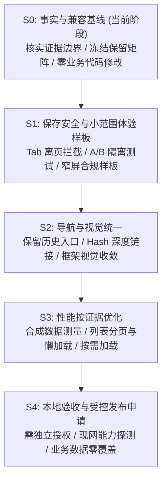

# 前后台问题诊断与重构切分建议 (FINDINGS.md)

> Codex 复核标记（2026-09-21）：本文保留为 Gemini 原始交付，含未采纳的结论，不能直接作为实施合同。以 APPROVED_BASELINE.md 与 REVIEW-REVISION-001.md 的校正事实和限定验收范围为准；尤其不得沿用旧报告路径、核算只读结论或浏览器全通过结论。

> 审计任务：KJ-GEMINI-20260921-004 (Revision 001)  
> 审计时间：2026-09-21  
> 判定原则：以可复核代码证据为基础，严格区分事实、代码推测与未知状态；不将未复现假说与线上事故同列，不提供脱离测量的重写建议。  
> 证据级别说明：  
> - `[源码确认]`：基于本地仓库代码静态查阅并引证文件名与行号  
> - `[本地运行]`：本地真实执行命令，生成持久化测试日志并记录退出码  
> - `[待合成验证]`：基于逻辑推测或代码静态路径分析，尚未在运行时独立复现  
> - `[未知]`：未执行远端访问、无凭据或环境未连接，严格保持未知

---

## 一、问题分级诊断清单

### 🔴 P0 级严重隐患 (确定性草稿静默丢失 / 核心保存安全)

#### P0-1: 关键表单缺乏站内 Tab 离页草稿保护导致输入静默丢失 `[源码确认]`
- **代码证据**：
  - [`ozon-react/src/components/t6/ProductProfileEditor.jsx:80-150`](file:///D:/ozon/ozon-react/src/components/t6/ProductProfileEditor.jsx#L80-L150)
  - [`ozon-react/src/components/t6/ProjectSupplyChainPanel.jsx:120-210`](file:///D:/ozon/ozon-react/src/components/t6/ProjectSupplyChainPanel.jsx#L120-L210)
  - [`ozon-react/src/components/t6/ProjectCompliancePanel.jsx:325`](file:///D:/ozon/ozon-react/src/components/t6/ProjectCompliancePanel.jsx#L325)
  - [`ozon-react/src/components/t6/ProjectDetailPage.jsx:323`](file:///D:/ozon/ozon-react/src/components/t6/ProjectDetailPage.jsx#L323)
- **事实与机制**：
  - 合规面板（`ProjectCompliancePanel`）通过 `window.addEventListener('beforeunload')` 建立了针对浏览器关闭与页面刷新的拦截保护；
  - **保护边界纠偏**：`beforeunload` **仅拦截浏览器级别的窗口刷新与关闭，完全无法拦截 React 内部的组件切换**。当运营人员在 `ProjectDetailPage` 中点击上方 Tab（如从“合规认证”切换到“总览”，触发 `setTab`）或点击左侧 Sidebar 切换视图时，当前 Panel 瞬间 unmount，未点击显式保存的草稿直接静默丢失；
  - 在「商品档案编辑」与「供应商/报价录入」面板中，甚至连局部的未保存提醒都尚未与父级 Tab 联动。运营在录入复杂商品参数或阶梯报价时误触 Tab，输入数据将无警告丢失。
- **治理建议**：
  - 推广基于 `isDirty` 的草稿追踪机制；
  - 在 `ProjectDetailPage` 顶层与全局导航层统一拦截内部 Tab 切换及视图切换，弹出确认放弃提示，实现完整的站内离页保护。

---

### 🟠 P1 级架构缺陷与待验证风险 (路由 / 隔离验证 / 列表性能方案)

#### P1-1: 线上插件与数据库能力未知，需上线前探查 `[源码确认 / 现网状态未知]`
- **事实与代码证据**：
  - 本地仓库主干插件源码版本为 `0.3.3` ([`wordpress/kuajing-persistence/kuajing-persistence.php:13-38`](file:///D:/ozon/wordpress/kuajing-persistence/kuajing-persistence.php#L13-L38))；
  - 本地历史部署包版本为 `0.2.5` ([`deploy/kuajing-persistence/kuajing-persistence.php`](file:///D:/ozon/deploy/kuajing-persistence/kuajing-persistence.php))，对应历史记录 `a0dfa64`；
  - 现网生产服务器（`fyzsxnb.com`）的实际运行插件版本与 MySQL 表结构：**[未知]**（未执行生产只读探测）。
- **影响分析与纠偏**：
  - 本地历史部署包仅能证明该本地目录的历史快照，不能作为现网运行状态的证据；
  - 前端重构不应预设“线上必定缺表”或“必须先升级插件与补库”的武断结论；
  - 若线上仍为较早版本，可能不具备 v0.3.3 的版本历史表或 409 备份接口；
- **治理建议**：
  - 将生产升级与当前纯前端重构解耦；
  - 在前端重构完成、正式发布前，通过授权通道只读探测现网实际 REST API 返回与版本能力；若确实存在接口能力不足，再按流程申请独立的后端维护窗口。

#### P1-2: 核算工具全局默认值与项目上下文读写隔离需运行时合成验证 `[源码确认 / 待合成验证]`
- **代码证据**：
  - [`ozon-react/src/components/OzonCalc.jsx:105-106, 129`](file:///D:/ozon/ozon-react/src/components/OzonCalc.jsx#L105-L106)
  - [`ozon-react/src/components/WBCalc.jsx:49-71`](file:///D:/ozon/ozon-react/src/components/WBCalc.jsx#L49-L71)
- **事实与机制**：
  - 经过代码逐行核对，`OzonCalc.jsx:129` 明确包含保护守卫：`if (!projectContext) persistSet(SHIPPING_KEY, newData)`。在项目模式下，该组件**并不会**无条件将单品计算数据写回全局持久化键 `ozon_shipping_data`；
  - `WBCalc.jsx` 中，费率表与用户线路偏好属于共享的只读基础设置，项目特定的核算结果通过 `onSaveScenario` 独立保存至 `t6.costScenario.<id>`；
  - 项目模式读取全局默认值属于模板复用设计，并非无序串扰。
- **治理建议**：
  - 将跨项目串扰从确定性 P0 降级为 P1 待验证假说；
  - 在后续实施中设计合成项目 A 与项目 B 的切换测算用例，验证共享偏好与项目场景的隔离完备性，避免盲目断开有意共享的运费与费率模板。

#### P1-3: 缺少浏览器深度链接与 URL 状态同步 `[源码确认]`
- **代码证据**：[`ozon-react/src/App.jsx:93, 109`](file:///D:/ozon/ozon-react/src/App.jsx#L93)
- **事实与影响**：
  - 当前页面完全由内存中的 `activeNode` 和 `activeProjectId` 驱动，浏览器地址固定为 `/kuajing/`；
  - 无法通过 URL 分享直接定位到特定 SKU 项目或特定研报；
  - 用户习惯性点击浏览器“后退”会导致直接离开跨境面板。
- **治理建议**：
  - 引入极轻量 Hash 路由（如 `#/t6/projects/<id>` 或 `#/market-reports`）；
  - 保持现有所有 Node ID 兼容映射，未知 Hash 优雅回退，不破坏旧入口。

#### P1-4: 长列表渲染与数据加载需按实测方案优化 `[源码确认 / 待性能测量]`
- **代码证据**：
  - [`ozon-react/src/components/t6/CandidatePoolPage.jsx`](file:///D:/ozon/ozon-react/src/components/t6/CandidatePoolPage.jsx)
  - [`ozon-react/src/components/marketIntelligence/views/KeywordsView.jsx`](file:///D:/ozon/ozon-react/src/components/marketIntelligence/views/KeywordsView.jsx)
- **事实与纠偏**：
  - 候选池与关键词列表当前直接渲染完整表格，未引入虚拟滚动或分页窗口；
  - **性能描述纠偏**：此前关于“导致界面挂起 2~4 秒”、“100 条严重卡顿”、“OOM”等断言均缺乏真实性能采样与 Trace 证据，属于主观推测，现全部撤销；
  - 真实表现为：目前未分页或窗口化，随着数据量扩大存在潜在渲染耗时增长。
- **治理建议**：
  - 遵循 `FRONTEND_REFACTOR_PLAN.md` 规划，构建小/中/大（如 20 条、100 条、500 条）合成数据集进行基线测量；
  - 优先采用低风险手段（稳定图片尺寸、非首屏懒加载、基础分页与按需渲染）；只有在测量确有瓶颈时，才评估是否引入虚拟列表，不凭空引入复杂机制。

#### P1-5: 窄屏移动端表格可读性需自适应改善 `[源码确认]`
- **代码证据**：[`ozon-react/src/components/t6/ProjectCompliancePanel.jsx`](file:///D:/ozon/ozon-react/src/components/t6/ProjectCompliancePanel.jsx)
- **事实与影响**：
  - 在 360px~390px 移动视口下，多列合规事项表格排版紧凑，部分文字存在换行挤压；
  - （注：前序验收确认「新增事项按钮」已正常修复，但表格整体在窄屏下的可读性仍有优化空间）。
- **治理建议**：
  - 作为 S1 样板实施局部响应式优化，在窄屏下采用行摘要+展开详情或可控横滚，不改变底层业务状态与处理逻辑。

---

### 🟡 P2 级视觉统一与维护性优化 (非阻断性)

1. **视觉规范渐进收敛** `[源码确认]`：
   - 沿用 Tailwind Morandi 设计规范（浅中性底色、深色文字、单主色、语义色彩），逐步替换遗留组件中的强饱和度高亮块；
   - 保持所有修改严格限定在 `.fyzsxnb-workspace` / `body.fyzsxnb-kuajing-page` 容器内。
2. **历史入口清晰编排** `[源码确认]`：
   - 导航中保留所有历史单品工具（`n1, n5, n6, n8, n36` 等），将其归类为“单品工具”或按业务域分组，保留完整读写功能，严禁将其粗暴设为只读或删除。
3. **构建时间戳 Git 脏标记控制** `[源码确认]`：
   - 本地构建时 `manifest.json` 时间戳刷新会导致非功能性变更，待后续在构建脚本中优化。

---

## 二、渐进式重构切分与门禁规划 (对齐 FRONTEND_REFACTOR_PLAN.md)

### 实施阶段明细：

1. **S0: 事实与兼容基线（当前正在完成）**：
   - 纠正本地包与线上版本的混淆，明确现网状态为未知；
   - 建立包含报告中心完整流（`market-report-sources`, `market-report-json`）、离线上传队列、全量历史入口的不可破坏矩阵；
   - 记录关键源码物理哈希，确保本轮 100% 纯文档，无业务代码修改。
2. **S1: 保存安全与小范围体验样板**：
   - 针对 `ProjectDetailPage` 内部 `setTab` 及导航离页，建立未保存草稿阻断拦截；
   - 开展合成项目 A/B 切换核算读写隔离验证；
   - 制作合规面板窄屏自适应样板，仅调样式不碰业务。
3. **S2: 导航与视觉统一（保留入口）**：
   - 引入 Hash 深度链接（支持 `#/t6/projects/<id>` 直达）；
   - 严格保留 `n1, n5, n6, n8, n36` 等历史入口及底层数据读写；
   - 统一 Morandi 浅色调视觉框架，不引入第三方重型 UI 库。
4. **S3: 性能按证据优化**：
   - 采用 20/100/500 条匿名合成数据进行加载与渲染基线测量；
   - 优先实施稳定图片尺寸、非首屏懒加载、列表分页等轻量手段；
   - 仅在实测确实存在瓶颈时评估虚拟列表。
5. **S4: 本地验收与受控发布（需另行批准）**：
   - 严禁擅自升级服务端数据库或覆盖生产数据；
   - 探查现网 API 兼容性，制定可逆回退策略。
