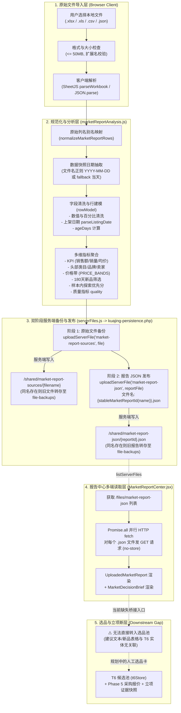

# DATA_FLOW.md — 市场报告到工厂选品全链路数据流与身份模型分析

> **任务编号**：KJ-GEMINI-20261012-MARKET-PLAN-002  
> **任务类型**：只读调查与下一阶段优化策划  
> **调查执行者**：Gemini  
> **状态**：`running` (本地调查完成)  
> **执行约束**：只读调查，禁止修改业务与生产代码，不修改任何计算公式与 Gate。

---

## 一、全链路物理数据拓扑图



---

## 二、数据字段、时间戳与身份边界深度核验

### 1. 核心标识符与时间戳矩阵

通过对 `ozon-react/src/utils/marketReportAnalysis.js`、`MarketReportCenter.jsx` 和 `UploadedMarketReport.jsx` 的源码逐行核验，各项字段的实际来源与语义定义如下：

| 字段概念 | 代码字段名 | 实际生成/解析位置 | 真实数据来源与语义 | 存在缺陷与边界风险 |
|---|---|---|---|---|
| **文件名** | `sourceFile` | `options.sourceFile \|\| file.name` | 用户上传时的本地文件名（如 `ozon-2026-05-12-gloves.xlsx`） | 仅为客户端本地命名，不可信且容易人为修改或重名。 |
| **报告身份 ID** | `id` | `marketReportAnalysis.js:504` `stableMarketReportId(fileName)` | 对 `fileName.toLocaleLowerCase()` 计算 32-bit FNV-1a 哈希，前缀 `uploaded-` | **P0 缺陷**：仅取决于文件名字符串！内容改变、大小改变、批次改变，只要文件名一致，ID 100% 相同。 |
| **采样快照日** | `snapshot` | `marketReportAnalysis.js:524` | `options.snapshot \|\| sourceFile.match(/\d{4}-\d{2}-\d{2}/)?.[0] \|\| new Date().toISOString().slice(0, 10)` | **P0 缺陷**：若文件名不含日期，**隐式回退为用户浏览器当天日期**，并在 UI 渲染为“数据快照 YYYY-MM-DD”，严重误导历史数据。 |
| **导入/发布时间** | `publishedAt` | `MarketReportCenter.jsx:138` | `new Date().toISOString()`（导入时刻的 ISO 字符串） | 代表生成并推送到服务器的时间戳，排序时降序排列。 |
| **商品上架时间** | `listingDate` | `marketReportAnalysis.js:135` `parseListingDate(val)` | 原始行中的 `上架时间` / `上架日期`（解析俄文 `DD.MM.YYYY`、Excel 序数或 ISO 格式） | 若原始表缺失该列，则为 `null`；部分数据存在未来日期或格式损坏。 |
| **商品存续天数** | `ageDays` | `marketReportAnalysis.js:529` | `Math.floor((snapshotDate - row.listingDate) / DAY_MS)` | **极度依赖 `snapshot` 准确性**。若快照日误用当天，历史数据的新品会被全盘算成老品。 |
| **来源链接** | `url` | `marketReportAnalysis.js:176` `safeUrl(row.url)` | 原始数据中的 `产品链接`（检查 `http:` / `https:`） | 允许为空，但 `newProducts` 列表严格过滤 `row.url !== ''`。 |
| **平台归属** | `source` / `group` | `buildUploadedMarketReport` | 静态标记为 `用户导入 Excel/CSV/JSON`，分组为 `导入报告` | 当前报告中心仅面向 Ozon BSR / 卖家中心导出数据。 |
| **品类/类型** | `type` | `rowModel(row).type` | 原始数据 `产品类型`，缺失默认为 `未分类` | 聚合为 `topTypes` 与 `typeOpportunities` 的分组基准。 |
| **规格与计量单位** | `volume` / `sales` | `rowModel(row)` | 原始数据 `商品体积(升)`、`销量(件)` | 仅解析基础数字；多包装、双数、单双折算等能力尚未沉淀到此模块。 |

---

### 2. “180 天新品”的真实判定机制与缺失表现

#### (1) 截点日期（Cut-off Date）机制
- **代码实现**（`marketReportAnalysis.js:526-531, 563-566`）：
  ```javascript
  const snapshot = options.snapshot || sourceFile.match(/\d{4}-\d{2}-\d{2}/)?.[0] || new Date().toISOString().slice(0, 10)
  const snapshotDate = parseListingDate(snapshot)
  const rows = normalizedRows.map(rowModel).map((row) => ({
    ...row,
    ageDays: row.listingDate && snapshotDate
      ? Math.floor((snapshotDate.getTime() - row.listingDate.getTime()) / DAY_MS)
      : null,
  }))
  const validListingRows = rows.filter((row) => Number.isFinite(row.ageDays) && row.ageDays >= 0 && row.ageDays <= 3650)
  const freshRows = validListingRows.filter((row) => row.ageDays <= 180)
  ```
- **截点事实**：
  - 截点基准日期是 **`snapshotDate`**（数据快照日），而不是固定当前系统时间；
  - 但如果文件名未带日期，`snapshotDate` 被强行赋予 `new Date()`。

#### (2) 日期缺失或文件无日期时的页面表现（实测核验）
当上传的文件无日期或 `上架时间` 列全为空时：
1. `listingDateCoverage` 评估为 `0%`；
2. `freshRows` 为空数组 `[]`（`freshProductCount = 0`）；
3. 在 `MarketDecisionBrief.jsx` 中，180天新品表格被替换为提示警示条：
   > “当前没有同时满足有效日期、180 天窗口和有效商品链接的记录，不跨日期补位。”
4. 在选品建议第 2 条（`recommendations[1]`）中呈现降级建议：
   > **先补齐新品日期再判断上新机会**（低置信度）  
   > “当前上架日期覆盖不足，不应据此判断新品趋势；优先补抓头部商品上架时间，再建立 180 天新品对标清单。”  
   > 数据依据：`有效上架日期覆盖 0% · 当前可识别新品 0 个`
5. **严禁的行为与现状违背点**：
   虽然代码在 `listingDate` 缺失时未编造虚假新品，但当文件名没有包含快照日期时，系统**把用户导入当天的当前日期直接写为“数据快照 2026-10-12”**。对于历史批次而言，这是严重的虚假时间戳标注。

---

### 3. 数据质量异常分类与当前代码处理逻辑

| 异常类型 | 实际判定逻辑 | 处理表现与代码位置 | 是否剔除/修复 |
|---|---|---|---|
| **缺失销售额** | `!FIELD_ALIASES.revenue.some(...)` | 直接抛出致命错误，阻断导入（`marketReportAnalysis.js:517`） | 抛错拦截 |
| **缺失销量** | `numeric(model.sales) === null` | `kpis.totalSales` 仅累加有效值；`quality.missingSales` 计数并展示在警示框中 | 保留行，仅在销量汇总中排除 |
| **缺失标价/均价** | `numeric(model.avgPrice) === null` | `priceBands` 过滤掉 `avgPrice === null`；`quality.missingAveragePrice` 记录缺失数 | 保留行，排除出价格带计算 |
| **重复 SKU** | `skuValues.length - new Set(skuValues).size` | 在 `quality.duplicateSku` 中计数并在警示框显示：“SKU 重复 N 条” | **未去重！** 两行数据均进入统计，销售额被双重计算 |
| **重复 URL** | `urlValues.length - new Set(urlValues).size` | 在 `quality.duplicateUrl` 中计数并在警示框显示：“产品链接重复 N 条” | **未去重！** 同样累加双重销售额 |
| **未来上架日期** | `row.ageDays < 0` | 计数为 `quality.futureListingDateCount`，从 `validListingRows` 中排除，不进入 180 天新品 | 排除出新品榜，保留在普通行 |
| **陈旧异常日期** | `row.ageDays > 3650` (10年以上) | 计数为 `quality.outlierListingDateCount`，从 `validListingRows` 排除 | 排除出新品榜，保留在普通行 |

---

## 三、三个重点问题的实证核验

### 1. 重点 1：`stableMarketReportId(fileName)` 的冲突覆盖与版本丢失实测

#### (1) 最小复现脚本与实测输出
在 Node 环境执行：
```javascript
const m = await import('./ozon-react/src/utils/marketReportAnalysis.js')
console.log(m.stableMarketReportId('hair_dryer.xlsx')) // -> uploaded-bacccda5
console.log(m.stableMarketReportId('HAIR_DRYER.XLSX')) // -> uploaded-bacccda5
console.log(m.stableMarketReportId('data.xlsx'))       // -> uploaded-997badee
```
#### (2) 缺陷链条与用户可见后果
1. **同名即冲突**：若操作员在 5 月导入了 `gloves.xlsx`（1000条手套数据），在 10 月导入了更新后的 `gloves.xlsx`（另一批手套数据），由于文件名完全相同，`stableMarketReportId` 恒等于同一个 ID；
2. **服务端静默覆盖在线报告**：
   在 `MarketReportCenter.jsx:137-140`，前端固定生成名为 `${stableMarketReportId(file.name)}.json`（即 `uploaded-997badee.json`）并上传；
   后端 `kuajing-persistence.php:1176-1184` 检查目标文件存在后，将旧文件备份到 `file-backups/market-report-json/`，随后**直接覆盖** `/shared/market-report-json/uploaded-997badee.json`；
3. **UI 中旧报告完全蒸发**：
   前端 `loadUploadedReports()` 调用 `listServerFiles('market-report-json')`，该 API 只列出 `/shared/market-report-json/` 下的文件，根本不会读取 `file-backups`。
   因此，5 月的历史报告在界面上**瞬间消失**，直接被 10 月报告取而代之；
4. **前端承诺落空**：
   `MarketReportCenter.jsx:188` 文案向用户声明：“*同名文件再次导入会保留旧版本*”。然而用户在界面上没有任何入口能看到或恢复旧版本，实际上旧版本对业务完全不可用。

---

### 2. 重点 2：源文件成功但报告发布失败的中间状态调查

#### (1) 双阶段提交的非原子性事实
在 `MarketReportCenter.jsx` lines 132-142 中：
```javascript
// 阶段 1：备份原始文件
setPublishStatus({ type: 'working', text: `正在备份原始 ${fileType}…` })
const sourceResult = await uploadServerFile(SOURCE_NAMESPACE, file)
if (!sourceResult?.file) throw new Error(`服务器未确认原始 ${fileType} 备份。`)

// 阶段 2：发布聚合 JSON
setPublishStatus({ type: 'working', text: '正在发布报告…' })
const reportFileName = `${stableMarketReportId(file.name)}.json`
const publishedReport = { ...report, sourceBackup: sourceResult.file.name }
const reportFile = new File([JSON.stringify(publishedReport)], reportFileName, { type: 'application/json' })
const reportResult = await uploadServerFile(REPORT_NAMESPACE, reportFile)
if (!reportResult?.file) throw new Error('服务器未确认报告发布。')
```

#### (2) 故障场景分析与恢复能力评估
- **故障点 1：阶段 1 成功，阶段 2 网络中断或异常**
  - **服务器状态**：`/shared/market-report-sources/{filename}` 已持久化成功；但 `/shared/market-report-json/` 中没有任何对应的 JSON；
  - **客户端感知**：捕获异常，顶部显示红色错误条；
  - **可发现性**：**0%**。`loadUploadedReports()` 仅检索 `market-report-json`，永远不会去查询 `market-report-sources`。这导致原始数据在服务器沦为孤儿文件（Orphaned File），无人知晓且无法自动恢复。
- **故障点 2：阶段 1 被排队（IndexedDB `pending-uploads` 延后重试）**
  - 当网络不佳时，`uploadServerFile` 将原始文件推入 IndexedDB 队列并抛出异常：`Source file backup is queued and will retry automatically`；
  - **后果**：整个 `handleImport` 立即在 catch 块中断，阶段 2 的报告 JSON 甚至**未被构建并从未进入上传队列**！
  - 即使随后 IndexedDB 在后台将原始文件上传成功，因没有发布报告 JSON，报告中心依然永远不会出现该报告。

---

### 3. 重点 3：批量读取报告 JSON 的网络与渲染成本核验

#### (1) 代码实现
`MarketReportCenter.jsx` lines 84-100：
```javascript
const loadUploadedReports = useCallback(async () => {
  setLoadingUploaded(true)
  try {
    const files = await listServerFiles(REPORT_NAMESPACE)
    const loaded = await Promise.all(files
      .filter((file) => file.name.toLowerCase().endsWith('.json') && file.downloadUrl)
      .map(async (file) => {
        try {
          const response = await fetch(file.downloadUrl, { credentials: 'same-origin', cache: 'no-store' })
          if (!response.ok) return null
          const report = await response.json()
          return isUploadedMarketReport(report) ? { ...report, serverDownloadUrl: file.downloadUrl } : null
        } catch {
          return null
        }
      }))
    setUploadedReports(loaded.filter(Boolean).sort((a, b) => String(b.publishedAt).localeCompare(String(a.publishedAt))))
  } finally {
    setLoadingUploaded(false)
  }
}, [])
```

#### (2) 性能与稳定性瓶颈
1. **`O(N)` 全量 HTTP 请求并发风暴**：
   每次进入“市场报告中心”页面，或者点击刷新按钮，前端首先发 1 次请求列出文件列表，随后发起 **N 个并行的完整 JSON GET 请求**（N 为报告总数）；
2. **强制禁用 HTTP 缓存（`cache: 'no-store'`）**：
   每次请求都无视浏览器缓存，强行穿透到后端 PHP 与磁盘；
3. **单报告 JSON 体积大**：
   单个报告 JSON 包含完整的 KPI、Top10 品牌/卖家/品类、15 个头部商品对象、12 个新品对象、五维市场指标、执行摘要等，平均体积约 15KB - 30KB。
   若累积 30 份报告，页面初次加载就需要同时并发 30 个网络连接并下载约 1MB 文本；
4. **全量内存常驻与全量渲染**：
   所有 N 个报告的完整数据在加载后全部常驻在 `uploadedReports` state 中，导致内存无序膨胀，缺乏分页与元数据轻量层（Index/Summary）分离机制。

---

## 四、数据保留策略与可逆架构方案建议（用于下一阶段实施）

为了在后续实施中彻底解决上述缺陷，建议采取以下数据保留与身份方案（本任务不修改代码）：

1. **报告唯一身份三元组改造**：
   - 弃用单一文件名哈希，改用内容强哈希或复合键：
     `reportId = 'rep-' + sha256(sourceFileBytes).slice(0, 16) + '-' + (snapshotDate || 'undated')`
   - 同名不同批次生成不同 `reportId`，并在文件名和 UI 中明确版本与导入批次，彻底杜绝静默覆盖；
2. **双阶段原子性与孤儿恢复机制**：
   - 增加轻量级清单索引 `manifest.json`（或服务端报告目录列表）；
   - 在加载时，增加对 `market-report-sources` 中“已备份源文件但未发布报告”的孤儿检测能力，提供“重新解析并发布”的一键恢复动作；
3. **元数据（Summary）与详情（Detail）按需加载分离**：
   - 生成轻量元数据包（仅含 `id`, `label`, `snapshot`, `sample`, `publishedAt`, `kpis`）；
   - 报告列表中仅加载元数据；用户选中某份报告时，再按需请求该报告的详细指标与商品列表，将网络请求从 `O(N)` 降为 `O(1)`。
