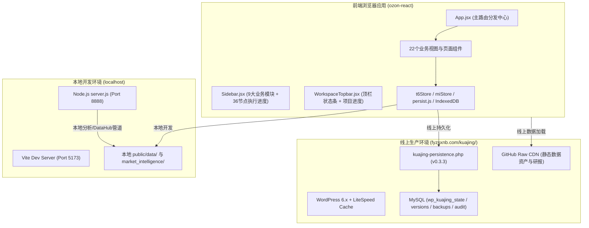
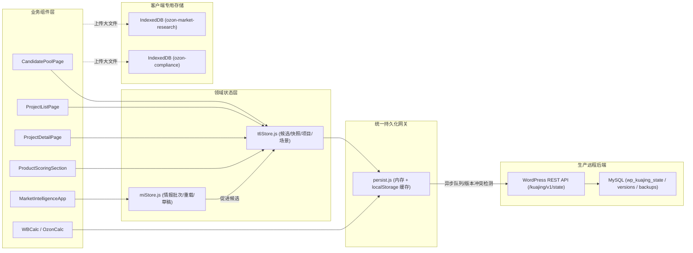
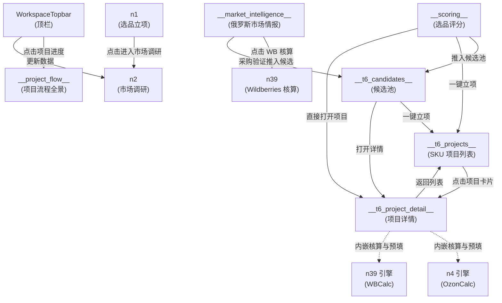

# `/kuajing` 跨境业务中台现有代码资产盘点报告 (Current System Inventory)

> **任务标识**：KUAIJING-IA-REFACTOR-V1 · TASK 01 (Gate A 交付物)  
> **审计基准**：Git Commit `de0cecf` (Tag: `market-intelligence-v1.1.1`)  
> **审计范围**：`ozon-react/` (前端)、`server.js` (价格与情报后端)、`wordpress/kuajing-persistence/` (生产持久化网关)、`scripts/` (构建与自动化管道)  
> **纪律说明**：本阶段为纯代码与架构审计，**零业务代码修改**。

---

## 目录

1. [系统整体拓扑与运行环境](#1-系统整体拓扑与运行环境)
2. [全量 Node 资产盘点总表](#2-全量-node-资产盘点总表)
3. [现有导航架构盘点（一级与二级导航）](#3-现有导航架构盘点一级与二级导航)
4. [核心页面 Component 结构清单](#4-核心页面-component-结构清单)
5. [状态管理与持久化机制清单 (Store)](#5-状态管理与持久化机制清单-store)
6. [后端 API 与数据资产清单](#6-后端-api-与数据资产清单)
7. [页面间已有跳转与数据流转关系](#7-页面间已有跳转与数据流转关系)
8. [核心业务功能承载映射（验收回答）](#8-核心业务功能承载映射验收回答)
9. [现有架构孤岛与痛点分析](#9-现有架构孤岛与痛点分析)

---

## 1. 系统整体拓扑与运行环境

`/kuajing` 跨境中台系统由两套对齐的运行环境组成：



---

## 2. 全量 Node 资产盘点总表

严格按照任务书要求，列出所有重点 Node 及系统核心 Node：

| Node ID | 当前名称 | Component (文件路径) | Store (状态存储) | API / 数据源 | 当前功能 | 当前入口 |
| :--- | :--- | :--- | :--- | :--- | :--- | :--- |
| `__market_intelligence__` | 俄罗斯市场情报 | `MarketIntelligenceApp.jsx`<br>`src/components/marketIntelligence/` | `miStore.js`<br>(localStorage: `mi_active_run_id`, `mi_validation_overrides_v1`), `t6Store.js` | 静态: `/data/market_intelligence/{runId}/*.json`<br>Node: `/api/market-intelligence/*` | 市场总览、选品雷达、利基分析、搜索词库、Phase 4 验证池、Phase 5 人工采购验证、DataHub 自动化上传管道 | 侧栏「市场与选品」第 1 项 |
| `n2` | 市场调研 | `MarketResearch.jsx`<br>`src/components/MarketResearch.jsx` | IndexedDB (`ozon-market-research`), `persist.js` (`market-research-active-file`) | WP: `/wp-json/kuajing/v1/files/market-research`<br>静态: `manifest.json` | 竞品大盘数据导入、爆款潜力分析、价格带分布、品牌集中度、价格弹性、PDF 导出 | 侧栏「市场与选品」第 2 项 / 路线图 Phase 1 节点 2 |
| `__purity_analysis__` | 选品市场分析 | `PurityPipelinePage.jsx`<br>`src/components/PurityPipelinePage.jsx` | `persist.js`<br>(`purity-checks-v1`, `purity-sample-history-v1`) | WP: `/wp-json/kuajing/v1/files/market-research`<br>静态: `manifest.json` | 原始热销数据纯度过滤（Tier A/B/C）、规格标准化（只/ml/g）、加权价格带测算、抽样置信度核查 | 侧栏「市场与选品」第 3 项 |
| `__market_reports__`<br>*(别名 `__door_window_report__`)* | 市场报告中心 | `MarketReportCenter.jsx`<br>`src/components/reports/` | Local state, `marketReportAnalysis.js` | WP: `/wp-json/kuajing/v1/files/market-report-json`<br>静态: `marketReports.js`, `recentMarketReports.js` | 24+ 份行业细分报告（汽车生态、家居门窗、宠物生活、数码）、决策简报预览、JSON 研报解析与发布 | 侧栏「市场与选品」第 4 项 |
| `__scoring__` | 选品评分 | `ProductScoringSection.jsx`<br>`src/components/dashboard/sections/` | `t6Store.js` (`ensureCandidate`, `buildScoringSnapshot`), Local state | 静态: `scoring_candidates.json`, `bsr_market_benchmarks.json`<br>配置: `scoring_rules.json` | 候选商品多维评分（5 大维度打分模型）、Grade 评级（A/B/C/D）、决策标签、指标下钻抽屉、一键立项 | 侧栏「市场与选品」第 5 项 |
| `n1` | 选品立项 / 立项决策 | `ProjectSetup.jsx`<br>`src/components/ProjectSetup.jsx` (包裹于 `NodePage.jsx`) | `persist.js` (`roadmap-statuses`), Local state | 本地数据: `MARKET_INFO`, `PRODUCT_CATEGORIES` | 宏观俄罗斯电商市场概况、平台选择、5 大预设品类画像评估、立项 checklist | 侧栏「市场与选品」第 6 项 / 路线图 Phase 1 节点 1 |
| `__t6_candidates__` | 候选池 | `CandidatePoolPage.jsx`<br>`src/components/t6/CandidatePoolPage.jsx` | `t6Store.js`<br>(`t6_workspace_v1`: `candidates`, `snapshots`) | 静态: `scoring_candidates.json`, `bsr_market_benchmarks.json` | 候选商品库管理、业务状态管理（观察/待调研/待立项/暂缓/淘汰）、负责人指定、工厂试制候选专区、一键立项 | 侧栏「商品中心」第 1 项 |
| `__t6_projects__` | SKU 项目 | `ProjectListPage.jsx`<br>`src/components/t6/ProjectListPage.jsx` | `t6Store.js`<br>(`t6_workspace_v1`: `projects`, `decisionLogs`) | `persist.js` 跨端同步 | 已立项 SKU 项目大盘看板、生命周期状态（草稿/进行中/暂缓/归档/淘汰）、阶段进度、项目卡片点击穿透 | 侧栏「商品中心」第 2 项 |
| `__t6_project_detail__` | 项目详情 | `ProjectDetailPage.jsx`<br>`src/components/t6/ProjectDetailPage.jsx` | `t6Store.js`, `gateEngine.js`, `stageTransition.js`, `costScenarioAdapter.js` | 嵌入 `OzonCalc` 与 `WBCalc` | 项目 36 节点工作流 Timeline、Stage Gate 关卡审核、生命周期操作、Ozon/WB 成本核算场景保存与基线锁定、决策审计日志 | 从 `ProjectListPage` 点击任意项目进入 |
| `n5` | 商品档案 / 产品定义 | `ProductDefinition.jsx`<br>`src/components/ProductDefinition.jsx` (包裹于 `NodePage.jsx`) | `persist.js` (`roadmap-statuses`) | 静态 SOP 指南与方法论库 | 产品定义全流程指南（功能定位/看差评找痛点、买家画像、差异化雷达图、规格定义标准） | 侧栏「商品中心」第 3 项 / 路线图 Phase 2 节点 1 |
| `n6` | 供应链协作 / 供应链开发 | `SupplyChain.jsx`<br>`src/components/SupplyChain.jsx` (包裹于 `NodePage.jsx`) | `persist.js` (`supply-chain-factories`) | 静态: `2026年Ozon平台供应链工厂目录0406.xlsx` | 供应链工厂信息库管理、按品类智能筛选、工厂资质/报价/产能/品控/样品打样记录跟踪、自定义新增编辑工厂 | 侧栏「供应链」 / 路线图 Phase 2 节点 2 |
| `n39` | Wildberries 核算 | `WBCalc.jsx`<br>`src/components/WBCalc.jsx` (包裹于 `NodePage.jsx`) | `persist.js` (`wb-settings-v1`, `wb-tariffs-v1`, `wb-skus-v1`, `wb-orders-v1`) | 计算引擎: `wbEngine.js`<br>配置: `wb_tariffs.json`, `wbConfig.js` | WB 跨境利润与物流费用核算（DPX 等 5 大线路）、逆向退货与拒收赔偿测算、多 SKU 利润表、线路对比、费率版本维护、订单对账导入 | 侧栏「平台运营」第 2 项 / 路线图 Phase 1 节点 5 |
| `__fbp_calc__` | FBP 边境仓核算 | `OzonFbpCalc.jsx`<br>`src/components/OzonFbpCalc.jsx` | `persist.js` (`fbp-calc-params-v1`, `fbp-calc-history-v1`) | 计算引擎: `ozonFbpEngine.js`<br>配置: `ozon_fbp_channels.json` | Ozon 边境仓 (FBP) 履约成本测算、多仓阶梯仓储费、特货限制（带电/带液）校验、渠道比选与测算历史留存 | 侧栏「物流与成本」第 2 项 |
| `n8` | 成本与报价锁定 / 物流与成本 | `CostQuote.jsx`<br>`src/components/CostQuote.jsx` (包裹于 `NodePage.jsx`) | `persist.js` (`cost-quote-data`) | 静态: `各供应商起订量及价格清单表.xlsx` | 供应商梯度报价清单管理、MOQ、价格条件对比、总成本结构拆解、报价修改与草稿暂存 | 侧栏「物流与成本」第 1 项 / 路线图 Phase 2 节点 5 |
| `n9` | 合规评估 | `ComplianceAssessment.jsx`<br>`src/components/ComplianceAssessment.jsx` (包裹于 `NodePage.jsx`) | IndexedDB (`ozon-compliance`), `persist.js` (`compliance-items`) | WP: `/wp-json/kuajing/v1/files/compliance` | 俄罗斯与欧亚联盟 EAEU/TR CU 法规合规项核对清单、禁限用成分排查、合规附件/证书文档上传与解析 | 侧栏「合规与账号」 / 路线图 Phase 3 节点 1 |
| `n14` | Listing 制作 | `ListingContent.jsx`<br>`src/components/ListingContent.jsx` (包裹于 `NodePage.jsx`) | `persist.js` (`roadmap-statuses`) | 静态文案与结构模板库 | 俄罗斯电商高转化 Listing SOP：10 张主附图结构、30 秒短视频脚本结构、俄语标题生成公式、五点描述与详情页模块设计指南 | 侧栏「平台运营」第 3 项 / 路线图 Phase 5 节点 1 |
| `n4` | Ozon 跨境核算 | `OzonCalc.jsx`<br>`src/components/OzonCalc.jsx` (包裹于 `NodePage.jsx`) | `persist.js` (`shipping-calc-rfbs-v2`, `product-pricing-v2`) | 计算引擎: `ozonEngine.js`<br>类目佣金: `COMMISSION_TABLE` | Ozon rFBS 跨境物流利润测算（CEL 等多渠道最低运费匹配）、多规格阶梯定价表、96+ 官方品类佣金查询、利润率警戒线判定 | 侧栏「平台运营」第 1 项 / 路线图 Phase 1 节点 3 |
| `__progress_overview__` | 工作台 (流程总览) | `ProgressOverview.jsx`<br>`src/components/ProgressOverview.jsx` | `persist.js` (`roadmap-statuses`) | 静态: `ROADMAP_PHASES`, `NODE_DETAILS` | 跨品类（吹风机、枕头、发膜、精油喷雾）7 阶段推进大盘、节点完成度统计、待办节点预警 | 侧栏「工作台」第 1 项 |
| `__project_flow__` | 项目流程全景 | `ProjectFlow.jsx`<br>`src/components/ProjectFlow.jsx` | `persist.js` (`project-flow-data-v2`, `notes`, `progress`) | 本地持久化 | 矩阵式项目全景视图（吹风机、枕头、发膜、精油、香薰、手套在样品/包材/核算/Listing 4 核心节点的执行大盘） | Topbar 顶栏右上角「项目进度」按钮 |
| `__node_overview__` | 数据与设置 | `NodeOverview.jsx`<br>`src/components/NodeOverview.jsx` | `persist.js` (`roadmap-statuses`) | 静态: `ROADMAP_PHASES` | 36 节点卡片矩阵总览（按产品板块、店铺板块、运营板块分类汇总）、各节点快速跳转与完成状态统计 | 侧栏「数据与设置」第 1 项 |
| `n36` | 香薰产品调研 | `FragrancePricing.jsx`<br>`src/components/FragrancePricing.jsx` | Local state, `persist.js` (`roadmap-statuses`) | 本地算法: `calcProfit`, `generateReport` | 香薰专属定价模型、方案 A/B 模拟、成本瀑布流净利润分解图、导出 PDF 商务谈判报告 | 路线图 Phase 1 节点 4 |
| `n7`, `n10`~`n12`, `n15`~`n35`, `n37` | 流程标准化节点 (共 22 个通用节点) | `NodePage.jsx`<br>`src/components/NodePage.jsx` | `persist.js` (`roadmap-statuses`) | 静态: `NODE_DETAILS` (checklist 与 desc) | 提供标准化的 SOP 执行清单（Checklist）、状态切换（待办/进行中/已完成）、阶段归属展示 | 底部展开「项目执行进度」Checklist 对应节点 |

---

## 3. 现有导航架构盘点（一级与二级导航）

当前系统的导航结构由 `Sidebar.jsx` 中的 `NAV_SECTIONS`、底部折叠块以及顶栏 `WorkspaceTopbar.jsx` 共同组成。

### 3.1 侧栏一级与二级业务导航 (`NAV_SECTIONS`)

```text
1. 工作台 (workspace)
   └── 工作台 [__progress_overview__]
2. 市场与选品 (market)
   ├── 俄罗斯市场情报 [__market_intelligence__]
   ├── 市场调研 [n2]
   ├── 选品市场分析 [__purity_analysis__]
   ├── 市场报告中心 [__market_reports__]
   ├── 选品评分 [__scoring__]
   └── 立项决策 [n1]
3. 平台运营 (platform)
   ├── Ozon [n4]
   ├── Wildberries [n39]
   └── Listing [n14]
4. 商品中心 (goods)
   ├── 候选池 [__t6_candidates__]
   ├── SKU 项目 [__t6_projects__]
   └── 商品档案 [n5]
5. 供应链 (supply)
   └── 供应链 [n6]
6. 物流与成本 (logistics)
   ├── 物流与成本 [n8]
   └── FBP 边境仓核算 [__fbp_calc__]
7. 合规与账号 (compliance)
   └── 合规与账号 [n9]
8. 回款与财务 (finance)
   └── 回款与财务 [n31]
9. 数据与设置 (data)
   └── 数据与设置 [__node_overview__]
```

### 3.2 侧栏辅助功能区

* **数据源面板（展开抽屉）**：
  * 支持拖拽与点击上传本地 Excel / CSV。
  * 自动拉取远程 `manifest.json` 文件列表（每 30 秒轮询），支持一键加载远程数据包。
  * 状态指示器：展示当前已解析数据条数（如“已加载 1000 条”）。
* **项目执行进度（底部折叠 Checklist）**：
  * 原 36 节点工作流保留入口，分为 7 个阶段（`phase-1` ~ `phase-7`）。
  * 显示全局完成度进度条（如 `12/36`）。
  * 未读更新通知小红点 / 蓝标（基于 `persistGet('node-updates')` 与 `persistGet('node-update-read-*')`）。

### 3.3 顶部导航区 (`WorkspaceTopbar.jsx`)

* **折叠/展开侧栏切换按钮**（支持 64px 图标窄轨模式）。
* **项目与市场概况**：“坪山综合保税项目 · 俄罗斯 · Ozon / Wildberries”。
* **全局执行状态监控**：
  * 当前阶段（第一个未完成的 Phase）。
  * 进度柱状图与分子分母（`done / total`）。
  * 最近更新时间戳（`lastUpdatedAt`）。
* **持久化同步指示器 (`PersistenceStatus.jsx`)**：
  * 显示当前设备与 WordPress 服务器同步状态（已同步 / 同步中 / 离线待同步）。
* **右侧快速动作按钮**：
  * `[更新数据]`：快速触发本地文件选择与数据解析。
  * `[项目进度]`：点击切换路由至 `__project_flow__`（项目流程全景看板）。

---

## 4. 核心页面 Component 结构清单

系统共登记 **22 个主页面/业务级组件**，其归属与层次结构如下：

### 4.1 市场与情报域
1. **`MarketIntelligenceApp.jsx`** (`src/components/marketIntelligence/`)
   * **子视图**：
     * `OverviewView.jsx`：宏观市场指标、宏观漏斗、类目趋势
     * `RadarView.jsx`：四象限机会雷达、高潜赛道聚类
     * `NichesView.jsx`：利基市场表格、供需比、垄断度、蓝海机会分
     * `KeywordsView.jsx`：搜索词库、DSI 供需指数、动态搜索
     * `ValidationPoolView.jsx`：Phase 4 验证池（TEST / VERIFY / WATCH / DROP）
     * `DataHubView.jsx`：数据更新自动化管道（上传、字段审计、运行 Phase 0-4、生成 Run）
   * **抽屉/弹窗**：
     * `NicheDetailDrawer.jsx`：利基详情拆解、品类画像、履约运费预估
     * `ManualProcurementWorkbench.jsx`：Phase 5 采购验证工作台（1688 渠道货源、报价对比、毛利预估、推入 T6 候选池）
2. **`MarketResearch.jsx`** (`src/components/MarketResearch.jsx`)
   * **子组件**：`NewDashboard.jsx` (新版看板), `Dashboard.jsx` (旧版看板)
   * **卡片与图表**：`KPICards`, `PriceBandAnalysis`, `PriceChart`, `BrandChart`, `PotentialProductsAnalysis`, `NewProductsAnalysis`, `PopularFeaturesAnalysis`, `PriceElasticityAnalysis`, `DataTable`, `AiImageGen`, `ExpertStrategy`
3. **`PurityPipelinePage.jsx`** (`src/components/PurityPipelinePage.jsx`)
   * **依赖库**：`purityFilter.js`, `priceBands.js`, `credibility.js`, `specParser.js`
4. **`MarketReportCenter.jsx`** (`src/components/reports/`)
   * **子组件**：`MarketDecisionBrief.jsx`, `UploadedMarketReport.jsx`, `RussiaMarketEntry.jsx`
5. **`FragrancePricing.jsx`** (`src/components/FragrancePricing.jsx`)
   * **子组件**：`InputField.jsx`, `PlanPanel.jsx`, `data.js`

### 4.2 选品评分与商品项目域 (T6 引擎)
6. **`ProductScoringSection.jsx`** (`src/components/dashboard/sections/`)
   * **子组件**：`ScoringPageHeader`, `ScoringOverview`, `ScoringToolbar`, `ScoringTable`, `ScoringDetailDrawer`, `ScoreCell`, `DecisionBadge`, `ContextBadge`, `RiskIndicators`
7. **`CandidatePoolPage.jsx`** (`src/components/t6/CandidatePoolPage.jsx`)
   * **子组件**：`FactoryTrialCandidatesSection.jsx`, `ScoreCell`, `DecisionBadge`, `ContextBadge`
8. **`ProjectListPage.jsx`** (`src/components/t6/ProjectListPage.jsx`)
   * **展示内容**：SKU 项目卡片、生命周期标签、进度环、立项快照回溯
9. **`ProjectDetailPage.jsx`** (`src/components/t6/ProjectDetailPage.jsx`)
   * **内置工作台**：
     * `WorkflowNodeRow`：项目级 36 节点独立状态与备注
     * `StageGate` 推进/回退面板与理由留痕
     * 成本核算 Tab：内嵌 `OzonCalc` 与 `WBCalc`（预填参数并生成不可变场景）
     * 决策日志 Timeline (`DecisionLog`)
10. **`ProductDefinition.jsx`** (`src/components/ProductDefinition.jsx`)
11. **`ProjectSetup.jsx`** (`src/components/ProjectSetup.jsx`)

### 4.3 平台核算与物流供应链域
12. **`WBCalc.jsx`** (`src/components/WBCalc.jsx`)
    * **Tab 页面**：
      * `OverviewTab.jsx`：经营总览看板
      * `CalculatorTab.jsx`：单订单核算器（含正向收益与逆向退拒赔偿）
      * `SkuTab.jsx`：SKU 利润总表
      * `CompareTab.jsx`：5 大跨境物流线路对比器
      * `TariffTab.jsx`：DPX 费率版本管理
      * `OrdersTab.jsx`：订单导入与批量对账
    * **共享部件**：`CategoryProductPicker`, `FormulaDisplay`, `MetricCard`, `ReverseOrderForm`, `ReverseOrderResult`
13. **`OzonCalc.jsx`** (`src/components/OzonCalc.jsx`)
    * **功能 Tab**：`单规格测算` (rFBS 运费与全渠道利润), `多规格对比` (阶梯定价), `佣金费率表` (96+ 类目)
14. **`OzonFbpCalc.jsx`** (`src/components/OzonFbpCalc.jsx`)
    * **功能**：绥芬河边境仓等 4 大渠道利润比选、仓储费阶梯、特货限制
15. **`CostQuote.jsx`** (`src/components/CostQuote.jsx`)
    * **功能**：供应商报价库、价格条件、起订量对比、编辑弹窗
16. **`SupplyChain.jsx`** (`src/components/SupplyChain.jsx`)
    * **功能**：工厂目录表、品类标签推导、资质与验厂记录管理
17. **`ComplianceAssessment.jsx`** (`src/components/ComplianceAssessment.jsx`)
    * **功能**：EAEU 合规核查、成分筛查、合规材料附件上传
18. **`ListingContent.jsx`** (`src/components/ListingContent.jsx`)
    * **功能**：主附图 10 张规范、30 秒短视频分镜、俄语 SEO 标题与五点描述

### 4.4 流程总览与工作台域
19. **`ProgressOverview.jsx`** (`src/components/ProgressOverview.jsx`)
20. **`ProjectFlow.jsx`** (`src/components/ProjectFlow.jsx`)
21. **`NodeOverview.jsx`** (`src/components/NodeOverview.jsx`)
22. **`NodePage.jsx`** (`src/components/NodePage.jsx`)
    * 标准节点容器：承载 22 个无专属 UI 的标准化流程节点（提供阶段标头、Checklist、状态切换操作、执行说明）。

---

## 5. 状态管理与持久化机制清单 (Store)

系统采用了**分层持久化模型**：轻量缓存走 IndexedDB/localStorage，结构化业务对象走 `persist.js` 统一网关并同步到 WordPress MySQL 后端。



### 5.1 核心持久化键 (State Keys) 全集

| 持久化 Key | 归属 Store / 模块 | 数据结构类型 | 存储内容与用途 |
| :--- | :--- | :--- | :--- |
| `t6_workspace_v1` | `t6Store.js` | JSON Object | T6 核心大对象：`candidates`, `snapshots`, `projects`, `decisionLogs`, `costScenarios` |
| `mi_active_run_id` | `miStore.js` | String | 市场情报当前激活的批次编号（如 `RUN-20260917-001`） |
| `mi_validation_overrides_v1` | `miStore.js` | JSON Object | 用户对市场情报 Phase 4 验证池的人工调整状态（`TEST` / `VERIFY` / `WATCH` / `DROP` 及备注） |
| `roadmap-statuses` | `App.jsx` / `NodePage.jsx` | JSON Object (`{ [nodeId]: 'pending' \| 'active' \| 'done' }`) | 全局 36 个流程节点的执行状态 |
| `node-updates` | `Sidebar.jsx` | JSON Object (`{ [nodeId]: [{ time, msg }] }`) | 节点未读更新通知记录 |
| `wb-settings-v1` | `WBCalc.jsx` | JSON Object | WB 核算全局配置（汇率、利润率阈值、默认线路） |
| `wb-tariffs-v1` | `WBCalc.jsx` | JSON Array | WB 跨境各物流线路阶梯运费表（DPX、超级经济、快线等） |
| `wb-skus-v1` | `WBCalc.jsx` | JSON Array | WB 核算面板的已录入 SKU 列表 |
| `wb-orders-v1` | `WBCalc.jsx` | JSON Array | WB 导入的订单记录与对账数据 |
| `shipping-calc-rfbs-v2` | `OzonCalc.jsx` | JSON Object | Ozon 单规格核算器的表单输入状态（独立模式） |
| `product-pricing-v2` | `OzonCalc.jsx` | JSON Array | Ozon 多规格对比核算器的产品定价行数据（独立模式） |
| `fbp-calc-params-v1` | `OzonFbpCalc.jsx` | JSON Object | Ozon FBP 边境仓核算参数（仓储天数、重量尺寸、采购成本） |
| `fbp-calc-history-v1` | `OzonFbpCalc.jsx` | JSON Array | Ozon FBP 测算历史方案快照列表 |
| `supply-chain-factories` | `SupplyChain.jsx` | JSON Array | 供应链工厂信息列表（含修改及自定义添加的工厂） |
| `cost-quote-data` | `CostQuote.jsx` | JSON Array | 供应商起订量及报价清单数据 |
| `compliance-items` | `ComplianceAssessment.jsx` | JSON Array | 合规评估检查项与勾选状态 |
| `purity-checks-v1` | `PurityPipelinePage.jsx` | JSON Object | 数据纯度抽样复核人工核对记录 |
| `purity-sample-history-v1` | `PurityPipelinePage.jsx` | JSON Array | 数据纯度历史抽样记录 |
| `project-flow-data-v2` | `ProjectFlow.jsx` | JSON Object | 多品类全流程推进大盘各节点条目 |
| `project-flow-notes-v1` | `ProjectFlow.jsx` | String | 流程全景备忘录笔记 |
| `product-progress-v1` | `ProjectFlow.jsx` | JSON Object | 各预设品类的进度统计 |

---

## 6. 后端 API 与数据资产清单

系统具备两套后端支持系统：**WordPress REST API**（支撑生产环境持久化）与 **Node.js `server.js`**（支撑本地数据处理与情报管道）。

### 6.1 WordPress REST API (`/wp-json/kuajing/v1/*`)
*文件：`wordpress/kuajing-persistence/kuajing-persistence.php` (v0.3.3)*

| 路由 Endpoint | 请求方法 | 鉴权要求 | 核心功能 | 对应数据库表 |
| :--- | :--- | :--- | :--- | :--- |
| `/session` | GET / POST / DELETE | 公开 / 校验口令 | 检查会话有效性、验证访问密码、注销退出登录 | Cookie: `fyzsxnb_kuajing_access` |
| `/state` | GET | `can_access` | 读取用户或全局的 key-value 业务状态 | `wp_kuajing_state` |
| `/state` | POST | `can_access` | 写入业务状态（含 `revision` 乐观锁并发控制、冲突自动备份） | `wp_kuajing_state`, `wp_kuajing_state_versions`, `wp_kuajing_state_backups` |
| `/state/history` | GET | `can_access` | 查询指定 key 的历史版本记录 | `wp_kuajing_state_versions` |
| `/state/backup` | POST | `can_access` | 创建指定 key 的快照备份 | `wp_kuajing_state_backups` |
| `/state/backups` | GET | `can_access` | 获取快照备份列表 | `wp_kuajing_state_backups` |
| `/state/restore` | POST | `can_access` | 将指定备份快照还原为当前有效状态 | `wp_kuajing_state`, `wp_kuajing_audit_events` |
| `/files/{namespace}` | GET | `can_access` | 列出指定命名空间下的文件（支持 `market-research`, `compliance`, `market-report-sources`, `market-report-json`） | WordPress uploads 独立私有目录 |
| `/files/{namespace}` | POST | `can_access` | 上传私有业务文件 | WordPress uploads 独立私有目录 |
| `/files/{namespace}` | DELETE | `can_access` | 删除私有业务文件 | WordPress uploads 独立私有目录 |

### 6.2 Node.js 服务端 API (`server.js` 端口 8888)
*文件：`server.js`*

| 路由 Endpoint | 请求方法 | 核心处理逻辑 | 依赖底层脚本 |
| :--- | :--- | :--- | :--- |
| `/api/data-version` | GET | 返回当前数据版本戳（文件变动自动递增） | `server.js` 内存变量 |
| `/api/market-intelligence/keywords` | GET | 搜索词库动态查询（支持 query、页码、排序） | `scripts/keywordsSearchService.cjs` |
| `/api/market-intelligence/upload` | POST | DataHub 文件上传（利基表/搜索词表） | `scripts/market_intelligence/pipelineRunner.cjs` |
| `/api/market-intelligence/run-pipeline`| POST | 触发 Phase 0~4 离线计算与前端编译 | `scripts/market_intelligence/pipelineRunner.cjs` |
| `/api/market-intelligence/pipeline-status`| GET | 查询管道执行进度与日志 | `scripts/market_intelligence/pipelineRunner.cjs` |
| `/api/market-intelligence/diff-report` | GET | 获取新旧 Run 之间的指标差异对比报告 | `scripts/market_intelligence/pipelineRunner.cjs` |
| `/api/market-intelligence/rollback` | POST | 回滚至上一稳定 Run | `scripts/market_intelligence/pipelineRunner.cjs` |
| `/api/market-intelligence/audit-log` | GET | 获取管道审计日志列表 | `scripts/market_intelligence/pipelineRunner.cjs` |
| `/api/summary` | GET | 获取市场价格清洗与比价匹配汇总统计 | `loadCleanedMarketData()`, `readAnalysisResults()` |
| `/api/results` | GET | 获取候选商品价格优势比对结果列表 | `RESULT_FILE` (Excel) |
| `/api/cleaned` | GET | 获取已清洗的市场商品库明细（支持搜索、过滤、分页） | `CLEANED_FILE` (JSON) |
| `/api/cleaned-summary` | GET | 获取已清洗市场数据的品牌、品类分布 | `CLEANED_FILE` (JSON) |
| `/api/rejections` | GET | 获取人工拒绝匹配记录 | `REJECTIONS_FILE` (JSON) |
| `/api/reject-candidate` | POST | 人工拒绝某项市场比价候选 | `REJECTIONS_FILE` (JSON) |
| `/api/restore-candidate` | POST | 恢复先前被拒绝的市场比价候选 | `REJECTIONS_FILE` (JSON) |
| `/api/export-filtered` | POST | 导出筛选后的比价分析结果为 Excel | `xlsx.write` |
| `/api/export` | GET | 导出全量比价分析 Excel 文件 | `RESULT_FILE` |

### 6.3 静态数据资产与配置唯一事实源

* **配置生成系统**：
  * 唯一源头：`config/*.json`（含 `settings.json`, `scoring_rules.json`, `wb_tariffs.json`, `market_analysis.json`）
  * 自动编译生成：`scripts/sync-config.js` $\to$ `ozon-react/src/generated/*.js`
* **静态业务文件**（位于 `ozon-react/public/data/` 或 GitHub Raw CDN）：
  * `manifest.json`：数据包清单
  * `scoring_candidates.json`：选品评分候选商品底表（40+ SKU 深度指标）
  * `bsr_market_benchmarks.json`：品类 BSR 基准大盘数据
  * `2026年Ozon平台供应链工厂目录0406.xlsx`：供应链名录预置包
  * `各供应商起订量及价格清单表.xlsx`：起订量与梯度价格清单
  * `market_intelligence/{runId}/`：最新批次的情报数据资产包（`market_overview.json`, `niche_radar.json`, `niche_database.json`, `keyword_opportunities.json`, `validation_pool.json`, `run_meta.json`）。

---

## 7. 页面间已有跳转与数据流转关系

当前系统各页面之间的跳转关系与数据透传链路如下：



### 详细跳转交互盘点：

1. **`MarketIntelligenceApp` $\to$ `WBCalc` (`n39`)**：
   * 触发点：利基详情抽屉 `NicheDetailDrawer` 中的「前往 WB 核算」按钮。
   * 机制：调用 props `onNavigateToWbCalc()`，切换 `activeNode` 为 `n39`。
2. **`MarketIntelligenceApp` $\to$ `CandidatePoolPage` (`__t6_candidates__`)**：
   * 触发点：采购验证工作台 `ManualProcurementWorkbench` 中的「推入候选池」按钮。
   * 机制：调用 `miStore.js` 中的 `promoteToT6Candidate()`，向 `t6Store` 的 `candidates` 写入新对象，并更新 `validationOverrides` 状态。
3. **`ProductScoringSection` $\to$ `CandidatePoolPage` (`__t6_candidates__`)**：
   * 触发点：评分详情抽屉 `ScoringDetailDrawer` 中的「加入候选池」按钮。
   * 机制：调用 `ensureCandidate()`，在 `t6Store` 中注册候选，并建立评分快照。
4. **`ProductScoringSection` $\to$ `ProjectDetailPage` (`__t6_project_detail__`)**：
   * 触发点：评分详情抽屉中的「一键立项」按钮。
   * 机制：调用 `createProject()` 生成 `SkuProject`，随后直接调用 `App.jsx` 的 `openProjectDetail(projectId)` 打开项目详情。
5. **`CandidatePoolPage` $\to$ `ProjectListPage` / `ProjectDetailPage`**：
   * 触发点：候选池卡片上的「创建项目」按钮。
   * 机制：复用最新评分快照创建 `SkuProject`，跳转进入项目。
6. **`ProjectListPage` $\to$ `ProjectDetailPage`**：
   * 触发点：点击项目卡片。
   * 机制：执行 `openProjectDetail(project.id)`，设置 `activeProjectId` 并切换 `activeNode = '__t6_project_detail__'`.
7. **`ProjectDetailPage` $\to$ `ProjectListPage`**：
   * 触发点：点击面包屑「返回项目列表」(`ArrowLeft`)。
   * 机制：调用 `onBack()`，切换 `activeNode = '__t6_projects__'`.
8. **`ProjectDetailPage` $\to$ 嵌入式核算面板**：
   * 触发点：项目详情内的「成本核算」Tab。
   * 机制：传入 `projectContext = { projectId, projectCode, prefill, onSaveScenario }`，在 `OzonCalc` 和 `WBCalc` 中预填商品重量、尺寸与采购价；保存时以不可变 `CostScenario` 格式写回 `t6Store`，不污染全局独立计算器缓存。

---

## 8. 核心业务功能承载映射（验收回答）

必须明确回答任务书验收核心问题：**每一个现有功能到底由哪个 Component、哪个 Store 和哪个 Node 承担？**

| 业务领域与核心功能 | 承担 Component | 承担 Store | 关联 Node ID | 备注与状态 |
| :--- | :--- | :--- | :--- | :--- |
| **俄罗斯市场宏观大盘与趋势** | `OverviewView.jsx` | `miStore.js` | `__market_intelligence__` | 生产已验收 (V1.1) |
| **选品四象限机会雷达** | `RadarView.jsx` | `miStore.js` | `__market_intelligence__` | 生产已验收 (V1.1) |
| **细分利基市场深度分析** | `NichesView.jsx`, `NicheDetailDrawer.jsx` | `miStore.js` | `__market_intelligence__` | 生产已验收 (V1.1) |
| **搜索词机会与供需指数 (DSI)** | `KeywordsView.jsx` | `miStore.js`, Node API | `__market_intelligence__` | 生产已验收 (V1.1) |
| **高潜利基 Phase 4 验证池** | `ValidationPoolView.jsx` | `miStore.js` (`mi_validation_overrides_v1`) | `__market_intelligence__` | 生产已验收 (V1.1) |
| **Phase 5 采购验证工作台** | `ManualProcurementWorkbench.jsx` | `miStore.js`, `t6Store.js` | `__market_intelligence__` | 生产已验收 (V1.1) |
| **DataHub 市场数据自动化管道** | `DataHubView.jsx` | Node API (`pipelineRunner.cjs`) | `__market_intelligence__` | 生产已验收 (V1.1) |
| **竞品大盘数据导入与深度调研** | `MarketResearch.jsx` (`NewDashboard.jsx`) | IndexedDB (`ozon-market-research`), `persist.js` | `n2` | 生产可用 |
| **热销数据纯度过滤与标准化** | `PurityPipelinePage.jsx` | `persist.js` (`purity-checks-v1`) | `__purity_analysis__` | 生产可用 |
| **品类细分研报与决策简报中心** | `MarketReportCenter.jsx` | Local state, `marketReportAnalysis.js` | `__market_reports__` | 生产可用 (含 24 份研报) |
| **香薰产品专项定价与谈判报告** | `FragrancePricing.jsx` | Local state, `persist.js` | `n36` | 生产可用 |
| **选品多维打分与 Grade 决策** | `ProductScoringSection.jsx` | Local state, `t6Store.js` | `__scoring__` | 生产可用 (T4-4B) |
| **宏观市场环境与立项指南** | `ProjectSetup.jsx` | `persist.js` (`roadmap-statuses`) | `n1` | 生产可用 |
| **高潜商品候选池与试制专区** | `CandidatePoolPage.jsx` | `t6Store.js` (`candidates`, `snapshots`) | `__t6_candidates__` | 生产可用 (T6-1) |
| **SKU 项目大盘与生命周期** | `ProjectListPage.jsx` | `t6Store.js` (`projects`) | `__t6_projects__` | 生产可用 (T6-1) |
| **项目工作流、关卡审核与核算场景** | `ProjectDetailPage.jsx` | `t6Store.js`, `gateEngine.js`, `stageTransition.js` | `__t6_project_detail__` | 生产可用 (T6-2A/B) |
| **产品定义 SOP 与差异化指南** | `ProductDefinition.jsx` | `persist.js` (`roadmap-statuses`) | `n5` | 生产可用 |
| **供应链工厂目录与资质打样** | `SupplyChain.jsx` | `persist.js` (`supply-chain-factories`) | `n6` | 生产可用 |
| **供应商报价对比与成本锁定** | `CostQuote.jsx` | `persist.js` (`cost-quote-data`) | `n8` | 生产可用 |
| **Wildberries 5 大线路跨境利润核算**| `WBCalc.jsx` | `persist.js` (`wb-settings-v1`, `wb-tariffs-v1`), `wbEngine.js` | `n39` | 核心引擎 (禁改公式) |
| **WB 买家取消/拒收/退货逆向赔偿** | `CalculatorTab.jsx`, `ReverseOrderForm.jsx` | `wbEngine.js` | `n39` | 核心引擎 (禁改公式) |
| **WB 订单导入与批量对账** | `OrdersTab.jsx` | `persist.js` (`wb-orders-v1`) | `n39` | 生产可用 |
| **Ozon rFBS 全渠道运费与利润测算**| `OzonCalc.jsx` | `persist.js` (`shipping-calc-rfbs-v2`), `ozonEngine.js` | `n4` | 核心引擎 (禁改公式) |
| **Ozon 官方 96+ 类目佣金查询** | `OzonCalc.jsx` (`commission` Tab) | `ozonEngine.js` (`COMMISSION_TABLE`) | `n4` | 核心引擎 |
| **Ozon FBP 边境仓履约与阶梯仓储** | `OzonFbpCalc.jsx` | `persist.js` (`fbp-calc-params-v1`), `ozonFbpEngine.js` | `__fbp_calc__` | 核心引擎 |
| **EAEU 合规清单与检测认证附件** | `ComplianceAssessment.jsx` | IndexedDB (`ozon-compliance`), `persist.js` | `n9` | 生产可用 |
| **俄语高转化 Listing 规范与脚本** | `ListingContent.jsx` | `persist.js` (`roadmap-statuses`) | `n14` | 生产可用 |
| **多品类 7 阶段执行大盘工作台** | `ProgressOverview.jsx` | `persist.js` (`roadmap-statuses`) | `__progress_overview__` | 生产可用 |
| **多品类 4 核心节点推进全景** | `ProjectFlow.jsx` | `persist.js` (`project-flow-data-v2`) | `__project_flow__` | 生产可用 |
| **36 节点状态矩阵与配置入口** | `NodeOverview.jsx` | `persist.js` (`roadmap-statuses`) | `__node_overview__` | 生产可用 |
| **标准化流程节点 (打样/QC/广告/回款等)**| `NodePage.jsx` | `persist.js` (`roadmap-statuses`) | `n7`, `n10`~`n12`, `n15`~`n35`, `n37` | 通用 SOP 容器 |

---

## 9. 现有架构孤岛与痛点分析

基于本次全量代码盘点，当前系统虽然功能完备且计算引擎高度精确，但在信息架构（IA）上存在以下四大结构性痛点：

### 痛点 1：业务对象割裂，未形成闭环流水线
* **现状**：
  * 用户在「俄罗斯市场情报」中发现高潜利基（如“发泡胶枪”），点击推入候选池；
  * 但在「选品评分」页面中，评分子系统使用的是另一套静态底表 `scoring_candidates.json`；
  * 进入「候选池」后，用户可以立项为「SKU 项目」；
  * 但进入「项目详情」的成本核算时，虽然能预填候选数据，却无法直接把选品情报中的市场参考价、建议零售价一键同步过去。
* **影响**：业务对象存在 `Opportunity (情报利基)`、`Scoring Candidate (评分候选)`、`T6 Candidate (池候选)`、`SKU Project (立项项目)` 多个阶段，但各页面缺乏主线串联，用户感觉像是在操作 4 个独立的软件。

### 痛点 2：页面职责与入口重叠，认知成本高
* **现状**：
  * `__scoring__` (选品评分) 与 `__t6_candidates__` (候选池) 都展示了综合得分、Grade、DecisionBadge，且两处都能看到商品评分，用户不清楚“我到底应该在评分页立项，还是去候选池立项”；
  * `__progress_overview__` (工作台)、`__project_flow__` (项目流程全景)、`__node_overview__` (数据与设置) 以及侧栏底部的 `项目执行进度` 四个地方都在展示 36 个节点的完成情况，存在四重入口与视图重叠。

### 痛点 3：核算工具脱离业务项目，呈孤岛化
* **现状**：
  * `WBCalc` (WB 核算) 和 `OzonFbpCalc` (FBP 核算) 在侧栏作为顶级独立工具存在；
  * 用户单独打开时需要手动录入商品的毛重、尺寸、采购成本；
  * 虽然 `ProjectDetailPage` 已经支持将 `WBCalc` 和 `OzonCalc` 作为子组件嵌入，但很多运营人员仍然习惯在侧栏独立工具里测算，导致测算结果没有沉淀在 SKU 项目中，无法被团队其他人员追溯。

### 痛点 4：专业数据分析与日常运营操作混合
* **现状**：
  * 侧栏「市场与选品」一次性堆放了 6 个功能：情报、调研、纯度分析、报告中心、评分、立项；
  * 其中「选品市场分析 (PurityPipelinePage)」是高阶的数据清洗校验工具，属于低频/管理员功能，却与高频的日常选品情报并列展示，造成侧栏臃肿。

---

## 10. 结论与 Gate A 验收判定

1. **代码安全遵守情况**：
   * 本任务未修改任何一行业务代码（`App.jsx`, `Sidebar.jsx`, `t6Store.js`, `miStore.js`, 各组件及核算公式均未变动）。
   * 跨平台测试套件 `npm test` 保持 100% 通过（96/96 测试全绿）。
2. **盘点覆盖度**：
   * 逐项摸清了系统内全部 22 个页面组件、36 个流程节点、21 个持久化键、18 个 Node API 路由、7 个 WordPress REST 路由。
   * 明确回答了任务书要求的每一个功能承载者。
3. **Gate A 达成结论**：
   * 现有系统代码资产与数据流向已彻底查清，具备进入 **Gate B (目标信息架构设计与数据迁移方案)** 的全部先决条件。
