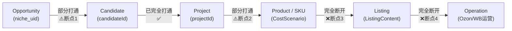

# `/kuajing` 现有资产到目标架构迁移映射与依赖审计

> **任务标识**：KUAIJING-IA-REFACTOR-V1 · TASK 02  
> **审计基准**：Git Commit `de0cecf` (Tag: `market-intelligence-v1.1.1`)  
> **关联底稿**：`docs/ia/CURRENT_SYSTEM_INVENTORY.md`  
> **纪律说明**：本阶段只制定资产迁移映射与依赖审计，**零业务代码修改**。

---

## 目录

1. [目标架构基准与业务对象关系](#1-目标架构基准与业务对象关系)
2. [表 1：一级导航迁移映射表](#2-表-1一级导航迁移映射表)
3. [表 2：页面组件到业务对象映射表](#3-表-2页面组件到业务对象映射表)
4. [表 3：多重入口与重复功能收敛映射表](#4-表-3多重入口与重复功能收敛映射表)
5. [表 4：Store 状态存储复用关系表](#5-表-4store-状态存储复用关系表)
6. [表 5：后端 API 复用关系表](#6-表-5后端-api-复用关系表)
7. [数据贯通缺口全链路审计](#7-数据贯通缺口全链路审计)
8. [双模式支持度审计（独立工具模式 vs 上下文模式）](#8-双模式支持度审计独立工具模式-vs-上下文模式)
9. [迁移难度分级与分布 (L1 ~ L4)](#9-迁移难度分级与分布-l1--l4)
10. [实施顺序与演进建议 (Recommended Execution Order)](#10-实施顺序与演进建议-recommended-execution-order)

---

## 1. 目标架构基准与业务对象关系

### 1.1 固定 8 大业务一级域

根据任务书第四条，系统最终一级导航锁定为 8 个业务域，禁止增删：

```text
1. 工作台 (Workspace)
2. 市场机会 (Market Opportunities)
   ├─ 俄罗斯市场情报
   └─ 市场报告
3. 选品与立项 (Selection & Initiation)
   └─ 候选池
4. 商品项目 (Product Projects)
   ├─ SKU 项目
   └─ 商品档案
5. 成本与物流 (Cost & Logistics)
   ├─ WB 核算
   ├─ FBP 核算
   └─ 成本报价
6. Listing 与上架 (Listing & Launch)
   └─ Listing 工作台
7. 运营与复盘 (Operations & Review)
   └─ Ozon 运营
8. 系统与数据 (System & Data)
   └─ 数据中心
```

### 1.2 核心业务对象主链条

系统业务对象严格按照单向价值流转，底层复用现有事实源，禁止新建重复 Store：

```text
Opportunity (利基机会, niche_uid)
    ↓
Candidate (选品候选, T6 candidateId)
    ↓
Project (SKU项目, T6 projectId / projectCode)
    ↓
Product / SKU (商品定义与规格, ProductDefinition / CostScenario)
    ↓
Listing (文案与详情页, ListingContent)
    ↓
Operation (平台运营与履约, OzonCalc / WBCalc)
```

---

## 2. 表 1：一级导航迁移映射表

> **处理方式枚举限定**：
> * `KEEP`：保留当前一级/二级位置，仅做展示升级。
> * `MOVE`：整块平移至目标一级域或二级入口。
> * `EMBED`：从主导航降级，作为子页面、抽屉或 Tab 嵌入至对应业务对象详情中。
> * `HIDE_FROM_MAIN_NAV`：从左侧业务主导航中移出，收敛入工作台待办、系统说明或通用容器。
> * `WRAP`：外层补充统一包装容器或聚合上下文后呈现。
> * `LEGACY_COMPAT`：兼容旧节点直连调用，标记为待整合。

| 当前分组 | 当前入口 | Node ID | 目标一级域 | 目标二级入口 | 处理方式 | 说明与演进依据 |
| :--- | :--- | :--- | :--- | :--- | :--- | :--- |
| **工作台** | 工作台 | `__progress_overview__` | 1. 工作台 | 工作台首页 | `KEEP` | 升级为工作台核心大盘，聚合待办、候选状态、项目状态与异常事项 |
| **市场与选品** | 俄罗斯市场情报 | `__market_intelligence__` | 2. 市场机会 | 俄罗斯市场情报 | `MOVE` | 包含大盘总览、机会雷达、利基市场、搜索词库及验证池 |
| **市场与选品** | 市场调研 | `n2` | 2. 市场机会 | Opportunity Detail → 竞品与价格 (Tab) | `EMBED` | 从主导航降级；Context 存在时作为利基竞品调研 Tab 嵌入；无 Context 时保留独立工具模式 |
| **市场与选品** | 选品市场分析 | `__purity_analysis__` | 2. 市场机会 | Opportunity Detail → 纯度清洗 (Tab) | `EMBED` | 从主导航降级；作为利基数据清洗与加权价格带工具嵌入；保留独立工具模式 |
| **市场与选品** | 市场报告中心 | `__market_reports__` | 2. 市场机会 | 市场报告 | `MOVE` | 整合 24+ 份行业细分报告与导入报告能力 |
| **市场与选品** | 选品评分 | `__scoring__` | 3. 选品与立项 | Candidate Detail → 选品评分 (Drawer/Tab) | `EMBED` | 从主导航降级；有候选时嵌入展示五维评分与证据雷达；无候选时保留独立打分工具模式 |
| **市场与选品** | 立项决策 | `n1` | 3. 选品与立项 | Candidate → Project Gate (立项确认) | `EMBED` | 从主导航降级；作为候选进入正式立项时的审核门禁/Checklist 弹窗；保留 legacy 节点调用 |
| **商品中心** | 候选池 | `__t6_candidates__` | 3. 选品与立项 | 候选池 | `MOVE` | 承接市场情报/人工推荐的所有高潜商品，支持状态跟踪与试制专区 |
| **商品中心** | SKU 项目 | `__t6_projects__` | 4. 商品项目 | SKU 项目 | `MOVE` | 正式立项商品的全生命周期大盘，点击穿透至项目详情 |
| **商品中心** | 商品档案 | `n5` | 4. 商品项目 | 商品档案 | `MOVE` | 作为商品中心的基础规格与档案库，同时支持被 Project Detail 引用嵌入 |
| **供应链** | 供应链 | `n6` | 4. 商品项目 | Project Detail → 供应链 (Tab) | `EMBED` | 从主导航降级；在项目详情中作为工厂开发与打样跟踪 Tab 嵌入；保留全量名录独立查询模式 |
| **平台运营** | Wildberries | `n39` | 5. 成本与物流 | WB 核算 | `MOVE` | 保持独立物流与利润核算器，同时在 Project Detail 中作为嵌入核算引擎 |
| **物流与成本** | FBP 边境仓核算 | `__fbp_calc__` | 5. 成本与物流 | FBP 核算 | `MOVE` | 专注边境仓与特定渠道特货履约测算 |
| **物流与成本** | 物流与成本 | `n8` | 5. 成本与物流 | 成本报价 | `WRAP` | 整合供应商报价清单 (`n8`) 与基础合规费用 (`n9`)，提供结构化成本表 |
| **合规与账号** | 合规与账号 | `n9` | 4. 商品项目 / 5. 成本与物流 | Project Detail → 合规 / 成本报价合规项 | `EMBED` | 从主导航降级；核心法规与证书归入项目合规 Tab，合规成本融入成本报价 |
| **平台运营** | Listing | `n14` | 6. Listing 与上架 | Listing 工作台 | `MOVE` | 提供俄罗斯本地化主附图、视频分镜与俄语 SEO 制作指南，后续与 SKU 绑定 |
| **平台运营** | Ozon | `n4` | 7. 运营与复盘 | Ozon 运营 | `MOVE` | 整合 rFBS 跨境核算、类目佣金查询及后续运营放量与利润对账能力 |
| **回款与财务** | 回款与财务 | `n31` | 7. 运营与复盘 | Ozon/WB 运营 → 结算与对账 | `HIDE_FROM_MAIN_NAV` | 移出侧栏一级导航，作为运营与复盘域的二级功能或归入标准化通用节点 |
| **数据与设置** | 数据与设置 | `__node_overview__` | 8. 系统与数据 | 流程节点说明 (帮助抽屉/系统组件) | `HIDE_FROM_MAIN_NAV` | 移出主导航，不再作为日常业务入口，作为系统流程规则参考手册 |
| **市场情报子视图**| 数据中心 | `DataHubView` | 8. 系统与数据 | 数据中心 | `MOVE` | 从市场情报的内部 Tab 提格为全局数据中心主入口，管理市场数据文件上传、审计与管道执行 |
| **顶栏入口** | 项目流程全景 | `__project_flow__` | 4. 商品项目 | Project Detail → 项目流程 (全景视图) | `EMBED` | 从顶栏独立入口移入项目详情内部，作为产品在 4 核心节点推进的生命周期图 |
| **侧栏底部** | 项目执行进度 (36节点) | `ROADMAP_PHASES` | 全局辅助 | 底部收折 Checklist | `LEGACY_COMPAT` | 标记为「待后续整合」，保留折叠态与更新小红点，本轮不删除代码 |

---

## 3. 表 2：页面组件到业务对象映射表

> **目标业务对象限定**：`Workspace`, `Opportunity`, `Candidate`, `Project`, `Product`, `SKU`, `Listing`, `Operation`, `System`.

| 当前 Component (文件路径) | 当前 Node | 当前职责 | 目标业务对象 | 未来位置 | 是否保留独立工具模式 |
| :--- | :--- | :--- | :--- | :--- | :--- |
| `ProgressOverview.jsx` | `__progress_overview__` | 跨品类 7 阶段进度看板 | **Workspace** | 工作台 → 工作台首页 | 否 (作为全局主屏) |
| `MarketIntelligenceApp.jsx` | `__market_intelligence__` | 俄罗斯大盘/雷达/利基/词库/验证池 | **Opportunity** | 市场机会 → 俄罗斯市场情报 | 否 (作为情报主中心) |
| `MarketResearch.jsx` | `n2` | 竞品大盘、价格带、品牌份额、爆款潜力 | **Opportunity** | 市场机会 → Opportunity Detail (调研 Tab) | **是** (保留无 Context 时的独立调研分析) |
| `PurityPipelinePage.jsx` | `__purity_analysis__` | 热销数据清洗、规格归一、加权价格带 | **Opportunity** | 市场机会 → Opportunity Detail (纯度 Tab) | **是** (保留高阶数据清洗独立工具) |
| `MarketReportCenter.jsx` | `__market_reports__` | 24+ 细分品类研报、行业简报预览 | **Opportunity** | 市场机会 → 市场报告 | 否 (作为报告中心主入口) |
| `FragrancePricing.jsx` | `n36` | 香薰专属定价模型、净利瀑布流、PDF导出 | **Opportunity** / **Product** | 市场报告 → 专项案例 / 候选详情 | **是** (保留独立定价模拟器) |
| `ProductScoringSection.jsx` | `__scoring__` | 五维评分打分表、雷达证据、Grade判定 | **Candidate** | 选品与立项 → Candidate Detail (评分 Drawer/Tab) | **是** (保留独立打分工具模式) |
| `CandidatePoolPage.jsx` | `__t6_candidates__` | 候选商品池、业务状态、试制候选专区 | **Candidate** | 选品与立项 → 候选池 | 否 (作为候选池主入口) |
| `ProjectSetup.jsx` | `n1` | 宏观市场与类目选择、立项指南 | **Candidate** / **Project** | 选品与立项 → 立项 Gate 弹窗 | **是** (保留向导模式) |
| `ProjectListPage.jsx` | `__t6_projects__` | SKU 项目大盘卡片、生命周期状态 | **Project** | 商品项目 → SKU 项目 | 否 (作为项目大盘主入口) |
| `ProjectDetailPage.jsx` | `__t6_project_detail__` | 项目 36 节点工作流、Gate审核、场景锁定 | **Project** | 商品项目 → 项目详情 | 否 (作为项目管理核心工作台) |
| `ProjectFlow.jsx` | `__project_flow__` | 多品类 4 节点推进矩阵全景 | **Project** | 商品项目 → Project Detail → 项目流程 | 否 (整合为项目视图) |
| `ProductDefinition.jsx` | `n5` | 产品功能定位、买家画像、差异化规范 | **Product** | 商品项目 → 商品档案 (并嵌入 Project Detail) | **是** (保留独立方法论 SOP 手册) |
| `SupplyChain.jsx` | `n6` | 工厂名录库、资质与打样记录 | **Project** / **Product** | 商品项目 → Project Detail (供应链 Tab) | **是** (保留全量工厂库独立查询模式) |
| `CostQuote.jsx` | `n8` | 供应商梯度报价、MOQ、起订量对比 | **SKU** / **Project** | 成本与物流 → 成本报价 (并嵌入 Project Detail) | **是** (保留独立报价核算工具) |
| `ComplianceAssessment.jsx` | `n9` | EAEU 合规清单、成分筛查、附件证书 | **Product** / **Project** | 商品项目 → Project Detail (合规 Tab) | **是** (保留独立合规检测工具) |
| `WBCalc.jsx` | `n39` | WB 5 大线路运费、利润、逆向赔偿、对账 | **Operation** / **SKU** | 成本与物流 → WB 核算 (并嵌入 Project Detail) | **是** (具备完整双模式：独立计算器 + 项目预填) |
| `OzonFbpCalc.jsx` | `__fbp_calc__` | FBP 边境仓履约、阶梯仓储、渠道对比 | **Operation** / **SKU** | 成本与物流 → FBP 核算 (并嵌入 Project Detail) | **是** (保留独立边境仓测算工具) |
| `OzonCalc.jsx` | `n4` | Ozon rFBS 全渠道运费、多规格定价、佣金 | **Operation** / **SKU** | 运营与复盘 → Ozon 运营 (并嵌入 Project Detail) | **是** (具备完整双模式：独立计算器 + 项目预填) |
| `ListingContent.jsx` | `n14` | 俄罗斯 Listing 制作 SOP、图片与视频脚本 | **Listing** | Listing 与上架 → Listing 工作台 | **是** (保留独立制作规范指南) |
| `DataHubView.jsx` | `(子视图)` | 数据文件上传、字段审计、Phase 0~4 管道 | **System** | 系统与数据 → 数据中心 | 否 (提格为主入口) |
| `NodeOverview.jsx` | `__node_overview__` | 36 节点说明矩阵与状态汇总 | **System** | 系统与数据 → 节点说明 (帮助抽屉) | 否 (作为辅助说明组件) |
| `NodePage.jsx` | `(容器)` | 标准化节点 Checklist 与状态操作 | **Project** / **System** | 通用流程节点承载容器 | 否 (作为底层框架组件) |

---

## 4. 表 3：多重入口与重复功能收敛映射表

当前系统在“流程总览”与“市场调研”两个方向存在明显的入口重叠与认知混淆，具体收敛方案如下：

### 4.1 流程总览类功能重叠梳理 (`__progress_overview__` / `__project_flow__` / `__node_overview__` / `Checklist`)

| 功能入口 | 当前定位 | 冲突/重叠现状 | 目标收敛定位 | 具体处理动作 |
| :--- | :--- | :--- | :--- | :--- |
| **`__progress_overview__`** | 侧栏「工作台」 | 仅展示 4 个预设产品的 7 阶段进度条，缺少真实 SKU 项目与待办聚合 | **未来唯一的「工作台首页」** | **主入口**。升级为全局中枢，承载：待办事项、候选审核、项目进度、Listing 待办、异常预警 |
| **`__project_flow__`** | Topbar 右上角「项目进度」 | 以矩阵展示吹风机/发膜等 6 个产品在 4 个核心节点的进度，与工作台争夺全局大盘定位 | **Project 生命周期流程视图** | **降级为 Tab**。从顶栏移出，归入 `商品项目 → Project Detail → 项目流程`，作为单项目全生命周期甘特/推进视图 |
| **`__node_overview__`** | 侧栏「数据与设置」 | 按产品/店铺/运营板块展示 36 节点矩阵，属于静态流程架构与说明，不是日常高频业务 | **系统流程/节点说明参考手册** | **降级为帮助组件**。从主导航移出，归入 `系统与数据` 下的说明抽屉或作为全局 Help 弹窗 |
| **Sidebar 底部 Checklist** | 侧栏底部展开区 | 展示 7 阶段 36 节点树及完成度 `done/total`，四处重复展示同一套状态 | **全局进度快捷指示与直达入口** | **标记「待后续整合」**。暂保留折叠态，与工作台解耦，避免与主内容区抢占视觉焦点；代码完全保留 |

### 4.2 市场调研类功能重叠梳理 (`__market_intelligence__` / `n2` / `__purity_analysis__`)

| 功能入口 | 当前定位 | 冲突/重叠现状 | 目标收敛定位 | 具体处理动作 |
| :--- | :--- | :--- | :--- | :--- |
| **`__market_intelligence__`** | 侧栏「俄罗斯市场情报」 | 包含全俄大盘、雷达、利基、词库、验证池与采购工作台，是成熟的自动化情报管道 | **市场机会域核心主中枢** | **主入口**。作为「市场机会 → 俄罗斯市场情报」顶级入口，用户在此发现与初筛高潜机会 (`Opportunity`) |
| **`n2` (MarketResearch)** | 侧栏「市场调研」 | 依赖本地上传 Excel，展示价格带、竞品、品牌份额；与市场情报中的利基分析各自为政 | **Opportunity 细分竞品与定价支撑** | **降级为 Detail Tab 并保留工具模式**。无 context 时保留为通用调研工具；有利基上下文时自动承载该利基的竞品下钻 |
| **`__purity_analysis__`** | 侧栏「选品市场分析」 | 对热销底表执行清洗、过滤低纯度干扰、建立加权价格带；属于偏底层的分析中间件 | **Opportunity 数据纯度核实工具** | **降级为 Detail Tab 并保留工具模式**。移出主侧栏，在利基详情中作为「数据纯度与规格校准」高级抽屉；保留独立工具模式供数据人员使用 |

---

## 5. 表 4：Store 状态存储复用关系表

严格禁止在重构中新造 Store，全部复用现有存储事实源，并按需补充轻量 Adapter：

| Store 名称 | 物理文件路径 | 当前承载对象 | 未来承载对象 | 是否继续作为事实源 | 是否需要 Adapter | 说明 |
| :--- | :--- | :--- | :--- | :---: | :---: | :--- |
| **`t6Store.js`** | `ozon-react/src/utils/t6/t6Store.js` | `candidates`, `snapshots`, `projects`, `decisionLogs`, `costScenarios` | **Candidate**, **Project**, **SKU (CostScenario)** | **YES (唯一事实源)** | **NO** | 结构完备、已通过 65+ 自动化测试，作为商品立项与项目管理的核心核心状态机 |
| **`miStore.js`** | `ozon-react/src/utils/marketIntelligence/miStore.js` | `active_run_id`, `validation_overrides`, `manual_quotes`, `audit_logs` | **Opportunity** (利基机会) | **YES (唯一事实源)** | **ADAPTER_LATER** | 需封装一个 `OpportunityAdapter`，使得外部组件可以用统一的 `opportunityId / niche_uid` 访问利基属性 |
| **`persist.js`** | `ozon-react/src/utils/persist.js` | 21 个持久化键的 localStorage 缓存与 revision 控制 | **全局持久化桥梁** (Local + Remote 同步) | **YES (唯一事实源)** | **NO** | 保持不变，继续作为跨端同步至 WordPress MySQL 的唯一通讯层 |
| **`IndexedDB: ozon-market-research`** | 浏览器原生 IndexedDB (`files` store) | 用户上传的调研 Excel 文件 Blob | **Opportunity 原始附件存储** | **YES (唯一事实源)** | **ADAPTER_LATER** | 后续需提供按 `niche_uid` 关联文件的读取接口 |
| **`IndexedDB: ozon-compliance`** | 浏览器原生 IndexedDB (`files` store) | 合规证书、质检报告、word 附件 Blob | **Project / Product 合规附件存储** | **YES (唯一事实源)** | **ADAPTER_LATER** | 后续需支持按 `project_id` 关联检索合规文件 |
| **`wbConfig.js` / `wb_tariffs.json`** | `src/utils/wbConfig.js`, `config/wb_tariffs.json` | WB 跨境费率、线路参数与汇率配置 | **Operation / Cost 核算事实源** | **YES (唯一事实源)** | **NO** | 严禁改动任何费率与计算公式，保持单源映射 |
| **`ozonEngine.js` / `ozon_channels.json`** | `src/utils/ozonEngine.js`, `config/ozon_channels.json` | Ozon rFBS 渠道资费与 96+ 品类佣金表 | **Operation / Cost 核算事实源** | **YES (唯一事实源)** | **NO** | 严禁改动任何费率与计算公式，保持单源映射 |

---

## 6. 表 5：后端 API 复用关系表

所有 API 均保持零修改，未来仅在前端消费层封装 Adapter：

| API 路由 | 承载服务端 | 当前消费者 | 目标消费者 | 是否修改 | 后续风险与控制 |
| :--- | :--- | :--- | :--- | :---: | :--- |
| `/wp-json/kuajing/v1/session` | WordPress Plugin | `access.js` (访问会话管理) | 全局登录/权限检查 | **NO** | 零风险，会话与安全机制已稳定投产 |
| `/wp-json/kuajing/v1/state` | WordPress Plugin | `persist.js` (状态拉取与保存) | 全局业务数据持久化 | **NO** | 需注意大规模写入时的 revision 并发控制，现有机制已支持自动重试 |
| `/wp-json/kuajing/v1/state/history` | WordPress Plugin | 历史审计与数据回退组件 | 项目审计与版本回溯 | **NO** | 零风险 |
| `/wp-json/kuajing/v1/state/backup` | WordPress Plugin | 异常冲突自动备份机制 | 全局防丢容灾体系 | **NO** | 零风险 |
| `/wp-json/kuajing/v1/files/{namespace}` | WordPress Plugin | `serverFiles.js` (文件管理) | 调研/合规/研报文件存储 | **NO** | 维持 `market-research`, `compliance`, `market-report-sources` 命名空间 |
| `/api/market-intelligence/keywords` | Node `server.js` | `KeywordsView.jsx` | 市场机会 → 搜索词机会 | **NO** | 依赖本地 Node 运行，线上降级为静态词库索引 |
| `/api/market-intelligence/upload` | Node `server.js` | `DataHubView.jsx` | 系统与数据 → 数据中心 | **NO** | 核心数据更新管道，生产脚本已验收冻结 |
| `/api/market-intelligence/run-pipeline` | Node `server.js` | `DataHubView.jsx` | 系统与数据 → 数据中心 | **NO** | 离线计算调用，保持 Python 脚本原样执行 |
| `/api/market-intelligence/pipeline-status` | Node `server.js` | `DataHubView.jsx` | 系统与数据 → 数据中心 | **NO** | 状态轮询，零风险 |
| `/api/market-intelligence/diff-report` | Node `server.js` | `DataHubView.jsx` | 系统与数据 → 数据中心 | **NO** | 周期差异对比，零风险 |
| `/api/market-intelligence/rollback` | Node `server.js` | `DataHubView.jsx` | 系统与数据 → 数据中心 | **NO** | 批次回滚，零风险 |
| `/api/cleaned*` / `/api/summary` / `/api/results` | Node `server.js` | 比价分析与旧版调研模块 | 辅助价格参考工具 | **NO** | 仅用于本地比价，不阻断主线业务 |

---

## 7. 数据贯通缺口全链路审计

我们按照 `Opportunity → Candidate → Project → SKU → Listing → Operation` 完整业务链进行了逐段代码级字段审计：



### 7.1 全链路断点汇总表

| 链路阶段 (From $\to$ To) | 当前是否打通 | 当前已传递字段 | 核心缺失字段 (GAP) | 后续实施要求 (严禁本轮修改代码) |
| :--- | :---: | :--- | :--- | :--- |
| **1. Opportunity $\to$ Candidate** | **部分打通** | `source_system: 'WB_MARKET_INTELLIGENCE'`, `source_run_id`, `source_niche_id`, `name`, `categoryLeaf`, `notes` (内含 MOS/CFS/预估单重/均价文本) | 1. 结构化的 `source_niche_uid`（目前部分利基只有 name，无稳定 uid）；<br>2. 结构化数字字段（如 `market_reference_price`, `estimated_weight_g`, `cfs_score`）被拼成了 notes 字符串，导致无法直接用于后续模型打分 | 后续需由 Adapter 在推入候选池时补全结构化 `source_niche_uid` 与数值字段，避免信息降解为纯文本 |
| **2. Candidate $\to$ Project** | **完全打通** | `candidateId`, `sourceProductId`, `candidateName`, `category`, `categoryFull`, `creationSnapshotId` (含全套五维评分结果、输入参数、BSR 基准元数据) | 无明显缺失。`createProject()` 已实现 ID 驱动与引用一致性 fail-close 校验 | 已完全打通，立项时直接复用，后续无须重构 |
| **3. Project $\to$ SKU** | **部分打通** | `projectId`, `projectCode`, `prefill` (包含 `weight_kg`, `price_rub`, `dims`, `commission_rfbs`)，支持生成不可变 `CostScenario` | 1. 缺乏多规格 SKU 列表模型（目前一个 Project 仅承载单一候选和若干独立的核算场景，没有 `Project.skus[]` 实体）；<br>2. `ProductDefinition.jsx` 为纯静态指南，未与 `Project` 实例持久化绑定 | 后续在 Project 内部构建轻量 `skus` 引用，将 `CostScenario` 关联到具体的 SKU 规格上 |
| **4. SKU $\to$ Listing** | **完全断开** | 无。`ListingContent.jsx` 当前为无入参静态组件 (`export default function ListingContent()`) | 缺失全部关联字段：`project_id`, `sku_id`, `product_name`, `russian_title`, `selling_points`, `bullet_points` | **重大断点 (GAP)**。后续需将 `ListingContent` 包装为上下文组件，接收 `projectContext`，自动读取商品标题、规格与卖点草稿 |
| **5. Listing $\to$ Operation** | **完全断开** | 无。`OzonCalc` 与 `WBCalc` 目前作为独立核算器或项目成本场景存在，不知道 Listing 制作状态与上架链接 | 缺失 `listing_id`, `ozon_sku_id`, `wb_nm_id`, `fbo_fbs_mode`, `online_status` | **重大断点 (GAP)**。后续在运营域建立商品档案与平台在线商品对照表，打通从 Listing 上架到回款运营的链路 |

---

## 8. 双模式支持度审计（独立工具模式 vs 上下文模式）

为了实现“既能作为独立工具快速测算，又能嵌入项目自动预填带入”，对系统各关键组件的双模式改造难度进行审计：

| 组件名称 | 目标位置 | 双模式现状 | 改造评估分类 | 改造要点与技术细节 |
| :--- | :--- | :--- | :---: | :--- |
| **`WBCalc.jsx`** | 成本与物流 / Project Detail | **已具备雏形**。通过 `projectContext` 传入 `{ projectId, prefill, onSaveScenario }`，可自动预填重量并保存不可变场景 | `DIRECT_REUSE` | 当前代码已原生支持双模式，无须大改，直接复用 |
| **`OzonCalc.jsx`** | 运营与复盘 / Project Detail | **已具备雏形**。通过 `projectContext` 传入 `{ projectId, prefill, onSaveScenario }`，可自动预填长宽高与佣金 | `DIRECT_REUSE` | 当前代码已原生支持双模式，直接复用 |
| **`OzonFbpCalc.jsx`** | 成本与物流 / Project Detail | 纯独立工具模式。参数强依赖本地 `persistGet('fbp-calc-params-v1')`，无外部 props 注入接口 | `WRAPPER_REQUIRED` | 需要增加 `projectContext` props，包装一个适配器允许从项目快照中注入重量与尺寸，并支持导出场景快照 |
| **`CostQuote.jsx`** | 成本与物流 / Project Detail | 纯独立工具模式。直接操作全局 `cost-quote-data`，缺乏项目上下文过滤能力 | `WRAPPER_REQUIRED` | 需增加过滤或关联能力：独立模式展示全部供应商报价；项目模式下根据品类或项目已选供应商高亮显示 |
| **`SupplyChain.jsx`** | 商品项目 / Project Detail | 纯独立工具模式。直接操作 `supply-chain-factories`，未与项目打样记录打通 | `WRAPPER_REQUIRED` | 独立模式作为全量工厂库；项目模式下支持一键为当前项目“指定供应商”并记录在项目日志中 |
| **`MarketResearch.jsx`** | 市场机会 / Opportunity Detail | 强绑定 IndexedDB 与本地文件上传，图表组件层级较深 (`NewDashboard.jsx`) | `ADAPTER_REQUIRED` | 需增加 `opportunityContext`：当有利基关键词时，自动筛选对应品类数据；否则保持全大盘模式 |
| **`ProductScoringSection.jsx`** | 选品与立项 / Candidate Detail | 数据强绑定静态 `scoring_candidates.json`，虽能一键立项，但无法按单个传入候选单独评分 | `ADAPTER_REQUIRED` | 需提取单一候选评分展示组件，由外部传入 `candidateDoc` 直接渲染指标雷达与判定卡片 |
| **`ListingContent.jsx`** | Listing 与上架 / Project Detail | 纯静态展示组件，零状态注入，包含大篇幅文字与模板大纲 | `WRAPPER_REQUIRED` | 需外包一层 `ListingWorkbench`：独立模式展示 SOP 模板；上下文模式下自动填充俄语标题生成器并支持保存草稿 |
| **`ComplianceAssessment.jsx`** | 成本与物流 / Project Detail | 强绑定全局 `compliance-items` 与 IndexedDB，未按项目隔离 | `WRAPPER_REQUIRED` | 独立模式下作为法规全书；项目模式下作为该项目的合规核查 Checklist |

---

## 9. 迁移难度分级与分布 (L1 ~ L4)

按照任务书规范，所有迁移项统一标定实施难度级别：

* **`L1`**：纯导航移动，无代码结构变化，仅改动 `Sidebar.jsx` 数组配置。
* **`L2`**：需要 Wrapper 包装或 Props 属性注入（双模式支持）。
* **`L3`**：需要 Store Adapter 或跨模块上下文桥接。
* **`L4`**：涉及底层数据模型或持久化协议变更（**本阶段严禁实施**）。

### 9.1 全组件迁移难度分布总表

```text
[L1 纯导航移动] (8 项)
  ├── 俄罗斯市场情报 (__market_intelligence__) ──> MOVE
  ├── 市场报告 (__market_reports__) ──> MOVE
  ├── 候选池 (__t6_candidates__) ──> MOVE
  ├── SKU 项目 (__t6_projects__) ──> MOVE
  ├── 商品档案 (n5) ──> MOVE
  ├── WB 核算 (n39) ──> MOVE (独立入口)
  ├── Ozon 运营 (n4) ──> MOVE (独立入口)
  └── 数据中心 (DataHubView) ──> MOVE

[L2 Wrapper/Props 注入] (7 项)
  ├── 工作台首页 (__progress_overview__) ──> WRAP 聚合待办与项目统计
  ├── FBP 核算 (__fbp_calc__) ──> WRAP 支持 projectContext
  ├── 成本报价 (n8/n9) ──> WRAP 整合报价与合规费用
  ├── 供应链协作 (n6) ──> WRAP 嵌入 Project Detail 并保留全量库
  ├── Listing 工作台 (n14) ──> WRAP 增加草稿与项目标题参数注入
  ├── 立项决策 Gate (n1) ──> WRAP 改造为立项审核确认弹窗
  └── 项目流程全景 (__project_flow__) ──> WRAP 嵌入 Project Detail

[L3 Store Adapter / 上下文桥接] (3 项)
  ├── Opportunity Detail 外壳 ──> 需要把 miStore 利基与调研/纯度数据桥接
  ├── 选品评分嵌入 (ProductScoringSection) ──> 需实现单候选评分数据适配
  └── 市场调研嵌入 (MarketResearch) ──> 需实现按利基品类过滤的适配器

[L4 数据模型与持久化变更 - 严禁本轮实施] (2 项，已严格冻结)
  ├── 冻结项 A: Project 内部完整的多规格 SKU 子实体模型定义与持久化表结构调整
  └── 冻结项 B: Listing 与线上平台店铺在线 Listing 的实时双向数据同步与履约对账
```

---

## 10. 实施顺序与演进建议 (Recommended Execution Order)

根据任务书第十五条，实施顺序已被严格锁定为 9 个步骤。下表给出每一步骤的执行依据与难度定级：

| 步骤序号 | 任务阶段名称 | 核心执行内容 | 对应难度级别 | 预期产出与验证标准 |
| :---: | :--- | :--- | :---: | :--- |
| **1** | **Sidebar 导航重组** | 严格按照 8 大一级业务域重构 `Sidebar.jsx` 中的 `NAV_SECTIONS`，移动节点入口，隐藏低频节点，保留底栏 Checklist 兼容态 | **L1** | 侧栏呈现 8 大业务域；点击所有 8 个一级与二级入口均能正常渲染对应既有页面 |
| **2** | **Opportunity Detail 外壳** | 为「市场机会」构建统一利基抽屉/页面外壳，将 `MarketResearch` (`n2`) 与 `PurityPipelinePage` (`__purity_analysis__`) 作为 Tab 嵌入 | **L3** | 用户在市场情报中点击任一利基，可在同一容器内完成画像浏览、竞品调研与纯度清洗 |
| **3** | **Candidate Detail 聚合** | 为「候选池」补充统一详情抽屉，将 `ProductScoringSection` 的五维雷达与证据卡片按单候选方式嵌入，替代主侧栏冗余入口 | **L3** | 候选池卡片支持点击查看完整打分详情；原独立选品评分页降级但不丢失功能 |
| **4** | **Candidate $\to$ Project Gate** | 将 `n1` (选品立项决策) 改造为候选池推入 SKU 项目时的确认弹窗与准入校验门禁 (Gate) | **L2** | 立项时必须校验目标市场、类目定位与关键属性，符合标准方可正式生成 SKU 项目 |
| **5** | **Project Detail 聚合** | 完善 `ProjectDetailPage.jsx`，将供应链 (`n6`)、成本报价 (`n8`)、合规 (`n9`) 及项目流程全景 (`__project_flow__`) 挂载至对应 Tab | **L2** | 单个 SKU 项目内部即可完整推进 36 节点工作流、查询匹配供应商、锁定成本场景 |
| **6** | **Context Bar (上下文条)** | 在工作台顶部实现面包屑与上下文贯通指示器，跨页面漫游时保持当前选中的 `niche_uid` 或 `project_id` | **L2** | 用户从项目跳往 WB 核算或 Listing 时，顶栏保留上下文并自动预填，避免手工重复录入 |
| **7** | **Workspace 首页** | 升级 `ProgressOverview.jsx`，聚合全局核心业务指标、高潜候选观察、进行中项目看板与异常卡点预警 | **L2** | 登录首屏即为高价值运营中枢，回答“今天我需要处理什么” |
| **8** | **Legacy Node Compatibility** | 实施旧节点兼容层，确保所有收藏的直接链接、历史书签及底层 nodeStatuses 能正确路由至新位置 | **L1** | 任意输入旧 Node ID（如 `n39`, `n4`, `n14`）均能精准导流至对应新版双模式容器 |
| **9** | **End-to-End Acceptance** | 全链路端到端验收测试，覆盖 `Opportunity → Candidate → Project → SKU → Listing` 完整流程，运行全套单元测试与黄金案例 | **L1** | `npm test` 与 `npm run test:sync` 100% 绿灯，系统信息架构重构闭环验收 |

---

## 11. 总结

本映射报告已彻底完成现有代码资产到任务书固定 8 大业务域的逐一归位，理清了多重入口的收敛策略，定位了业务链条的 4 个关键数据断点，并制定了从 L1 到 L3 的安全落地路径。

**本轮未修改任何业务代码与 Store/API 文件，资产处于绝对安全就绪状态。**
