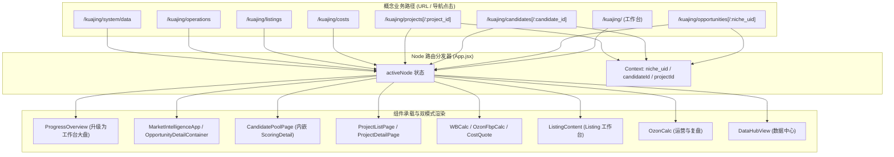

# `/kuajing` 目标路由矩阵与旧节点兼容契约 (Target Route Matrix & Legacy Compatibility)

> **任务标识**：KUAIJING-IA-REFACTOR-V1 · TASK 02  
> **设计原则**：本矩阵为**业务逻辑路由 / Node 路由调度契约**，非强制引入外部 React-Router 依赖；采用 `activeNode` + `Context State`（`activeNicheUid`, `activeCandidateId`, `activeProjectId`）驱动状态分发，确保双端无缝向下兼容。  
> **纪律说明**：只做路由契约设计，**零业务代码修改**。

---

## 目录

1. [目标业务路由架构设计](#1-目标业务路由架构设计)
2. [固定业务路径映射矩阵 (Route Matrix)](#2-固定业务路径映射矩阵-route-matrix)
3. [旧 Node 兼容矩阵 (Legacy Node Compatibility Matrix)](#3-旧-node-兼容矩阵-legacy-node-compatibility-matrix)
4. [双模式调度协议与参数契约 (Dual-Mode Context Contracts)](#4-双模式调度协议与参数契约-dual-mode-context-contracts)
5. [前端路由分发状态机伪代码模型](#5-前端路由分发状态机伪代码模型)

---

## 1. 目标业务路由架构设计

系统采用“**概念路径 (Semantic Path) $\leftrightarrow$ 状态机分发 (State Dispatcher)**”的解耦模型：
1. **对外呈现与概念统一**：遵循清晰的 RESTful 业务语义（如 `/kuajing/projects/:id`）。
2. **对内实现低成本升级**：继续复用 `App.jsx` 中的 `activeNode` 与内存上下文指针，不破坏现有的 WordPress 嵌入模式与白屏容错机制。



---

## 2. 固定业务路径映射矩阵 (Route Matrix)

按照任务书第四条确定的 8 大一级域，定义系统目标业务路由：

| 业务领域 | 概念业务路径 | 对应内部 Node ID | 承载组件 (Component) | 承载业务对象 | 默认视图 / 行为 |
| :--- | :--- | :--- | :--- | :--- | :--- |
| **1. 工作台** | `/kuajing/` | `__progress_overview__`<br>*(别名 `__workspace__`)* | `ProgressOverview.jsx` | **Workspace** | 全局主屏：待办聚合、候选预警、项目进展、Listing 待办与异常事项 |
| **2. 市场机会** | `/kuajing/opportunities` | `__market_intelligence__` | `MarketIntelligenceApp.jsx` | **Opportunity** | 俄罗斯市场情报总览、四象限机会雷达、利基市场数据库、搜索词机会库 |
| **2. 市场机会** | `/kuajing/opportunities/:niche_uid` | `__opportunity_detail__` | `NicheDetailDrawer.jsx`<br>+ `MarketResearch.jsx`<br>+ `PurityPipelinePage.jsx` | **Opportunity** | 利基深度抽屉/容器：画像拆解、竞品价格下钻 (Tab)、数据纯度清洗 (Tab)、采购验证 |
| **2. 市场机会** | `/kuajing/reports` | `__market_reports__` | `MarketReportCenter.jsx` | **Opportunity** | 行业报告中心：24+ 细分品类研报、决策简报与自定义报告导入 |
| **3. 选品与立项** | `/kuajing/candidates` | `__t6_candidates__` | `CandidatePoolPage.jsx` | **Candidate** | 高潜候选池大盘：业务状态推进（观察/待调研/待立项）、工厂试制候选专区 |
| **3. 选品与立项** | `/kuajing/candidates/:candidate_id` | `__candidate_detail__` | `ScoringDetailDrawer.jsx`<br>*(来自 ProductScoringSection)* | **Candidate** | 候选评分详情抽屉：五维指标雷达、证据拆解、Grade 评级、一键正式立项 Gate |
| **4. 商品项目** | `/kuajing/projects` | `__t6_projects__` | `ProjectListPage.jsx` | **Project** | SKU 项目列表大盘：生命周期标签（草稿/进行中/暂缓/归档）、进度百分比 |
| **4. 商品项目** | `/kuajing/projects/:project_id` | `__t6_project_detail__` | `ProjectDetailPage.jsx` | **Project** | 项目详情中枢：36 节点独立 Timeline、Stage Gate 关卡、成本场景锁定、决策日志 |
| **4. 商品项目** | `/kuajing/products` | `n5` | `ProductDefinition.jsx` | **Product** | 商品档案库与产品定义标准 SOP 手册（同时支持在项目详情内嵌入引用） |
| **5. 成本与物流** | `/kuajing/costs/wb` | `n39` | `WBCalc.jsx` | **Operation** / **SKU** | WB 跨境利润与物流费用核算器（独立模式：自由填写；项目模式：自动带入参数） |
| **5. 成本与物流** | `/kuajing/costs/fbp` | `__fbp_calc__` | `OzonFbpCalc.jsx` | **Operation** / **SKU** | Ozon FBP 边境仓履约核算器（多渠道比选、阶梯仓储费、特货限制） |
| **5. 成本与物流** | `/kuajing/costs/quote` | `n8` *(整合 `n9` 费用)* | `CostQuote.jsx` | **SKU** / **Project** | 供应商报价管理与结构化成本清单（起订量、包装、运输、合规费用拆解） |
| **6. Listing 与上架** | `/kuajing/listings` | `n14` | `ListingContent.jsx` | **Listing** | Listing 制作工作台：10 张主附图规范、30s 视频分镜、俄语 SEO 标题与五点描述 |
| **7. 运营与复盘** | `/kuajing/operations` | `n4` | `OzonCalc.jsx` | **Operation** | Ozon rFBS 跨境运营大盘、多规格阶梯定价、96+ 类目佣金查询、利润警戒线监控 |
| **8. 系统与数据** | `/kuajing/system/data` | `__data_hub__` | `DataHubView.jsx` | **System** | 市场数据自动化中心：利基表/搜索词表上传、字段审计、Phase 0~4 管道执行、版本回滚 |
| **8. 系统与数据** | `/kuajing/system/nodes` | `__node_overview__` | `NodeOverview.jsx` | **System** | 系统流程说明手册：36 节点矩阵结构、SOP 规则参考（移出业务主导航） |

---

## 3. 旧 Node 兼容矩阵 (Legacy Node Compatibility Matrix)

为保证现有书签、外部链接、流程 Checklist 以及已有数据库中的状态记录 100% 不失效，所有历史 Node 必须遵守以下兼容映射规则：

| 历史 Node ID | 历史名称 | 新业务归属与位置 | 独立模式 (无 Context) 行为 | 上下文模式 (有 Context) 行为 | 兼容技术机制 |
| :--- | :--- | :--- | :--- | :--- | :--- |
| **`n1`** | 选品立项 | 3. 选品与立项 → Candidate → 正式立项 Gate | 渲染原始宏观市场与类目指南界面 (`ProjectSetup`) | 作为候选池卡片推入项目时的准入审查确认弹窗 (Gate Modal) | 保留 legacy 调用，上下文存在时拦截并执行 Gate 校验 |
| **`n2`** | 市场调研 | 2. 市场机会 → Opportunity → 竞品与价格 | 打开全量竞品大盘调研与数据上传分析工具 (`MarketResearch`) | 自动筛选当前 `niche_uid` 对应品类的竞品、价格带与品牌分布 | 检查 `activeNicheUid`，有值则自动过滤数据 |
| **`n4`** | Ozon 跨境核算 | 7. 运营与复盘 → Ozon 运营 | 打开 Ozon rFBS 全渠道测算器与类目佣金表 (`OzonCalc`) | 作为 Project 成本核算子模块，预填项目长宽高与佣金，生成场景快照 | 检查 `projectContext`，有值则启用不可变场景保存模式 |
| **`n5`** | 商品档案 / 产品定义 | 4. 商品项目 → 商品档案 | 打开产品定义方法论与差异化标准手册 (`ProductDefinition`) | 嵌入 Project Detail 的「产品定义」Tab，作为项目规格输入依据 | 静态组件直接复用，通过外层注入当前项目 SKU 信息 |
| **`n6`** | 供应链开发 | 4. 商品项目 → Project Detail → 供应链 | 打开全量工厂目录库与查询检索界面 (`SupplyChain`) | 嵌入项目详情，展示当前品类已匹配工厂，记录样品打样进度 | 独立模式展示全部工厂；上下文模式按品类与项目 ID 过滤 |
| **`n8`** | 成本与报价锁定 | 5. 成本与物流 → 成本报价 | 打开供应商起订量与梯度价格清单表 (`CostQuote`) | 嵌入项目成本核算，快速选用并锁定供应商价格条件 | 支持无状态查阅，有项目时高亮匹配记录 |
| **`n9`** | 合规评估 | 5. 成本与物流 → 成本报价 / 4. 项目详情 | 打开 EAEU/TR CU 法规清单与附件上传工具 (`ComplianceAssessment`) | 嵌入项目详情合规 Tab，勾选并保存该项目的合规项 | 保留 `compliance-items` 全局存储，上下文模式带入项目 |
| **`n14`** | Listing 内容制作 | 6. Listing 与上架 → Listing 工作台 | 展示俄罗斯高转化 Listing 制作 SOP 与模板大纲 (`ListingContent`) | 读取当前 SKU 项目的品类与卖点，预填俄语标题生成器草稿 | 独立模式展示指南；上下文模式接收 `projectContext` |
| **`n36`** | 香薰产品调研 | 2. 市场机会 → 专项案例 / 报告 | 打开香氛定价模拟与净利瀑布流报告工具 (`FragrancePricing`) | 作为特定香薰项目的专属定价参考案例嵌入展示 | 保持独立组件完整可用性 |
| **`n39`** | WB 跨境核算 | 5. 成本与物流 → WB 核算 | 打开 WB 5 大线路独立运费计算器与订单对账表 (`WBCalc`) | 作为 Project 成本核算子模块，自动预填毛重与尺寸，生成场景快照 | 检查 `projectContext`，有值则锁定独立存储并支持项目存照 |
| **`__fbp_calc__`** | FBP 边境仓核算 | 5. 成本与物流 → FBP 核算 | 打开边境仓阶梯仓储与全渠道比选核算器 (`OzonFbpCalc`) | 嵌入项目物流核算，注入重量尺寸并测算边境仓收益对比 | 独立模式保留 `fbp-calc-params-v1` 本地持久化 |
| **`__scoring__`** | 选品评分 | 3. 选品与立项 → Candidate → 选品评分 | 展示全量候选商品五维评分表与导出工具 (`ProductScoringSection`) | 针对特定候选弹出抽屉，展示雷达证据、得分拆解与立项按钮 | 独立模式浏览全表；上下文模式单项精确展示 |
| **`__market_reports__`** | 市场报告中心 | 2. 市场机会 → 市场报告 | 展示 24+ 份行业研报中心 (`MarketReportCenter`) | 无须上下文，直接作为报告中心主入口 | 原样平移，零代码修改 |
| **`__progress_overview__`**| 流程总览 | 1. 工作台 → 工作台首页 | 展示多品类全局推进大盘 (`ProgressOverview`) | 升级为工作台，聚合待办与项目卡点 | 原样升级，作为默认路由 |
| **`__project_flow__`** | 项目流程全景 | 4. 商品项目 → Project Detail → 项目流程 | 从顶栏移出，降级为项目全生命周期流程视图 (`ProjectFlow`) | 嵌入项目详情内，展示 4 核心节点阶段进展 | 独立模式降级，主要作为项目内部流程视图 |
| **`__node_overview__`** | 数据与设置 | 8. 系统与数据 → 节点说明 (帮助手册) | 展示 36 节点说明矩阵 (`NodeOverview`) | 移出侧栏主导航，作为系统说明帮助抽屉打开 | 降低导航优先级，代码完整保留 |
| **`n7, n10~n12, n15~n35, n37`** | 标准化流程节点 (22个) | 4. 商品项目 → Project Detail / 流程容器 | 打开标准 `NodePage.jsx` Checklist 界面 | 在项目 36 节点 Timeline 中作为独立状态行维护并留痕 | 维持底层 `NodePage.jsx` 结构不变 |

---

## 4. 双模式调度协议与参数契约 (Dual-Mode Context Contracts)

为了让组件既能作为“独立计算/分析工具”，又能作为“项目/机会嵌入部件”，必须明确以下三套上下文协议标准：

### 4.1 `opportunityContext` (市场机会上下文)
当从市场情报或利基列表中下钻打开 `n2` (市场调研) 或 `__purity_analysis__` (纯度分析) 时传递：

```typescript
interface OpportunityContext {
  niche_uid: string;           // 利基全局唯一标识 (如 "wb_niche_17882470")
  niche_name: string;          // 利基名称 (如 "发泡胶枪")
  category_leaf: string;       // 叶子类目
  market_reference_price: number; // 市场参考均价 (RUB)
  estimated_weight_g: number;  // 预估单重 (g)
  active_run_id: string;       // 当前情报批次号
  is_contextual: boolean;      // 显式标记当前处于上下文模式
}
```
* **独立模式行为**：`opportunityContext = null` 时，组件自由上传 Excel 文件、显示全大盘数据。
* **上下文模式行为**：`opportunityContext` 有效时，组件自动根据 `category_leaf` 与 `niche_name` 进行数据过滤，并将分析成果自动关联至当前利基。

---

### 4.2 `candidateContext` (选品候选上下文)
当在候选池中点击任一候选查看评分详情 (`__scoring__`) 或立项审核 (`n1`) 时传递：

```typescript
interface CandidateContext {
  candidateId: string;         // T6 候选 ID
  sourceProductId: string;     // 原始商品编号 (如 "wb-niche-xxx" 或 "p-01")
  candidateName: string;       // 候选名称
  categoryFull: string;        // 完整类目路径
  latestSnapshotId: string;    // 最新五维评分快照 ID
  bizStatus: string;           // 业务状态 ('观察' | '待调研' | '待立项' | '暂缓' | '淘汰')
  owner: string;               // 负责人
  is_contextual: boolean;
}
```
* **独立模式行为**：展示全量 40+ SKU 评分表，支持全局多维筛选与导出。
* **上下文模式行为**：抽屉式精准渲染该候选的五维雷达图、强项、风险与立项确认按钮。

---

### 4.3 `projectContext` (SKU 项目上下文)
当在项目详情内部调用 `WBCalc` (`n39`)、`OzonCalc` (`n4`)、`OzonFbpCalc` (`__fbp_calc__`) 或 `ListingContent` (`n14`) 时传递（**该契约已在 T6-2B 落地验证**）：

```typescript
interface ProjectContext {
  projectId: string;           // SKU 项目全局唯一 ID
  projectCode: string;         // 项目编号 (如 "RU-2026-001")
  prefill: {
    price_rub?: number;        // 预填售价 (RUB)
    weight_kg?: number;        // 预填重量 (kg)
    length?: number;           // 长 (cm)
    width?: number;            // 宽 (cm)
    height?: number;           // 高 (cm)
    commission_rfbs?: number;  // Ozon rFBS 佣金率 (%)
    // 严禁虚构 purchaseCost 等成本假设，必须由运营真实填入
  };
  onSaveScenario: (scenarioDoc: CostScenario) => void; // 场景冻结回调
  is_contextual: boolean;
}
```
* **独立模式行为**：读写全局独立存储键（如 `wb-settings-v1`, `shipping-calc-rfbs-v2`），参数变动影响全局计算器。
* **上下文模式行为**：隔离全局持久化键，仅将测算结果以不可变 `CostScenario` 记录写回当前项目，杜绝多项目间数据串扰。

---

## 5. 前端路由分发状态机伪代码模型

在后续实施阶段，`App.jsx` 的核心分发逻辑将演进为以下结构（保持纯净，零外部依赖）：

```javascript
// App.jsx 未来 renderContent 路由状态机逻辑模型
function resolveActiveComponent({ activeNode, contextState }) {
  // 1. 工作台域
  if (activeNode === '__progress_overview__' || activeNode === '__workspace__') {
    return <ProgressOverview />
  }

  // 2. 市场机会域
  if (activeNode === '__market_intelligence__') {
    return <MarketIntelligenceApp onOpenOpportunity={(uid) => setContext('opportunity', uid)} />
  }
  if (activeNode === '__market_reports__') {
    return <MarketReportCenter />
  }

  // 3. 选品与立项域
  if (activeNode === '__t6_candidates__') {
    return <CandidatePoolPage onOpenCandidate={(cid) => setContext('candidate', cid)} />
  }

  // 4. 商品项目域
  if (activeNode === '__t6_projects__') {
    return <ProjectListPage onOpenProject={(pid) => setContext('project', pid)} />
  }
  if (activeNode === '__t6_project_detail__') {
    return <ProjectDetailPage projectId={contextState.activeProjectId} onBack={() => setActiveNode('__t6_projects__')} />
  }
  if (activeNode === 'n5') {
    return <ProductDefinition />
  }

  // 5. 成本与物流域
  if (activeNode === 'n39') {
    return <WBCalc projectContext={contextState.projectContext} />
  }
  if (activeNode === '__fbp_calc__') {
    return <OzonFbpCalc projectContext={contextState.projectContext} />
  }
  if (activeNode === 'n8') {
    return <CostQuote projectContext={contextState.projectContext} />
  }

  // 6. Listing 与上架域
  if (activeNode === 'n14') {
    return <ListingContent projectContext={contextState.projectContext} />
  }

  // 7. 运营与复盘域
  if (activeNode === 'n4') {
    return <OzonCalc projectContext={contextState.projectContext} />
  }

  // 8. 系统与数据域
  if (activeNode === '__data_hub__') {
    return <DataHubView />
  }
  if (activeNode === '__node_overview__') {
    return <NodeOverview />
  }

  // Legacy Node 兼容兜底
  return <NodePage nodeId={activeNode} />
}
```

---

## 6. 总结

本路由矩阵已完整锁定了目标 8 大业务域的概念路径与内部调度机制，为全量 36+ 历史 Node 设立了明确的兼容桥梁，并制定了标准化的双模式上下文契约。为下一步（TASK 03 导航结构实施改造）提供了唯一、精准、可执行的路由映射事实底表。
