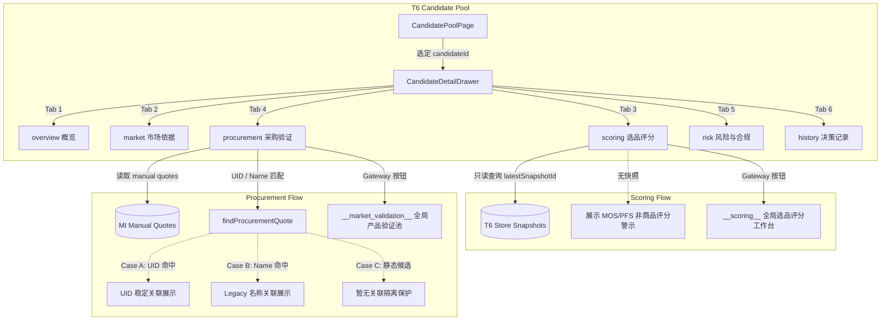

# KUAIJING-IA-REFACTOR-V1 · TASK 05B-2C

## Candidate「选品评分 / 采购验证」能力归位设计与集成报告

### 1. 任务性质与业务契约

本任务为 `KUAIJING-IA-REFACTOR-V1` 架构重构的阶段性任务（TASK 05B-2C），目标是将此前孤立在各自模块的**选品评分**与**采购验证**能力，在 `CandidateDetailDrawer.jsx`（候选商品详情抽屉）中实现**业务语义归位**。

#### 核心契约
- **严格 6 个业务 Tab**：`CandidateDetailDrawer` 由 TASK 05B-1 的 4 个只读 Tab 扩充为固定 6 个业务 Tab：
  1. `overview` (概览)
  2. `market` (市场依据)
  3. `scoring` (选品评分)
  4. `procurement` (采购验证)
  5. `risk` (风险与合规)
  6. `history` (决策记录)
- **只读与 Gateway 引导模式**：抽屉内部只读取合法持久化数据，展示结构化指标与来源凭据；不直接嵌入复杂的评分计算器或采购录入工作台，而是通过明确的 Gateway 引导跳转至全局工作台。
- **语义强隔离**：绝对禁止将 Market Intelligence 的 MOS / PFS 伪装为 T6 商品评分快照；无合法快照时严格展示警示文案。
- **零破坏原则**：不修改 Candidate Schema，不升级 `t6Store`，不直接向 Candidate 实体拷贝采购数据，不使用正则表达式反向解析 `notes`。

---

### 2. 选品评分归位设计 (`CandidateScoringGateway.jsx`)

选品评分能力在候选详情抽屉中的职责被严格定义为**“只读快照查看 + 全局工作台引导”**。

#### 功能实现
1. **快照解析展示**：
   - 依赖 `candidate.latestSnapshotId` 与 `t6Store.getSnapshot(id)`。
   - 若存在有效快照，展示快照 ID、生成时间、综合评分（`totalScore`）、评级（`grade`）、决策状态与建议动作（`decision.status` / `decision.action`）、置信度与证据覆盖率（`evidenceCoverage`）。
   - 展开展示商业可行性五维评分（市场需求、利润可行性、物流适配、竞争机会、价格空间、运营稳健）与 Supply Gap 信号。
   - 展示底层规则与模型版本元数据（`rulesVersion`、`engineVersion`、`candidateDatasetVersion`、`benchmarkVersion`）。
2. **缺失快照防御与语义隔离**：
   - 若候选商品无快照，展示醒目的警告卡片，明确告知：“当前 Candidate 尚未绑定合法 T6 Scoring Snapshot。Market Intelligence 的 MOS/PFS 属于市场机会指标，不能替代商品评分。”
   - 对于 `WB_MARKET_INTELLIGENCE` 来源的候选，追加补充说明：“现有 T6 Scoring 工作台以 canonical 商品数据为评分对象；本页不会将利基市场指标转换为商品评分。”
3. **Gateway 引导卡片**：
   - 提供“打开选品评分工作台”按钮，触发调用外部导航回调 `onOpenNode('__scoring__')`。
   - **免责与预过滤声明**：“当前评分工作台为全局商品评分工作台，不会自动筛选或定位到当前 Candidate。”

---

### 3. 采购验证归位设计 (`CandidateProcurementPanel.jsx`)

采购验证能力连接的是 Market Intelligence Phase 5 录入的人工询价成果。

#### 身份解析与数据关联三态规则
面板通过 `getManualQuotes()` 获取当前报价库，并基于 `findProcurementQuote` 执行严密的三态查找：

- **Case A: 稳定 UID 查找（优先）**
  - 条件：`candidate.source_niche_uid` 存在。
  - 逻辑：通过 `{ uid: candidate.source_niche_uid, name: candidate.candidateName }` 优先检索 `quotes[uid]`。
  - 状态：命中后标记为 `UID 稳定关联`（绿色徽章）。
- **Case B: Legacy 名称回退**
  - 条件：`!candidate.source_niche_uid && candidate.source_system === 'WB_MARKET_INTELLIGENCE'`。
  - 逻辑：仅对确认来源于 Market Intelligence 的老数据候选，回退使用 `{ name: candidate.candidateName }` 检索 `quotes[name]`。
  - 状态：命中后标记为 `Legacy 名称关联`（黄色徽章）。
- **Case C: 静态/非 MI 候选绝对隔离**
  - 条件：`candidate.source_system !== 'WB_MARKET_INTELLIGENCE' && !candidate.source_niche_uid`。
  - 逻辑：绝对不凭借候选名称盲目匹配 `quotes[name]`，直接判定 `quote = null`。
  - 状态：标记为 `暂无关联`。

#### 采购字段可视化
- **供应商与出厂**：供应商名称、供应商外链、出厂单价（¥）、起订量（MOQ）、实测单重（g）。
- **物流与测算**：长宽高包装尺寸、国内运费、国际头程运费、目标卢布售价、预估净利（¥）、预估毛利率（%）。
- **凭据与可信度**：综合可信度等级（如 `TIER1_CONFIRMED`）、价格凭证、规格凭证、物流凭证、合规凭证、最后更新时间。

#### 缺失状态与 Gateway
- 缺失采购记录时，区分说明 MI 候选与非 MI 静态候选的语义差异。
- 提供“打开市场情报验证池”按钮，触发调用 `onOpenNode('__market_validation__')`。
- **未预过滤声明**：“当前市场情报产品验证池为全局视图，不会自动筛选或定位到当前 Candidate。”

---

### 4. 零破坏与物理隔离策略

为防止系统复杂度和状态耦合蔓延，本轮重构严格遵循以下隔离防线：
1. **物理组件不嵌套**：
   - 严禁在抽屉中引入 `ProductScoringSection` 或 `ScoringDetailDrawer`。
   - 严禁在抽屉中引入 `ManualProcurementWorkbench`。
   - 抽屉与工作台保持松耦合。
2. **候选模式零变更**：
   - Candidate Schema 保持现有的 V1 标准，未添加采购相关字段。
   - 不向 Candidate 实体中深度复制 `quote` 数据，每次渲染由面板实时按 ID 查找，保证 Single Source of Truth（`mi_manual_procurement_quotes`）。
3. **零正则表达式反向解析**：
   - 绝对禁止对 `candidate.notes` 使用正则表达式反向解析提取价格、毛利或供应商字段。所有展示字段均直接来自结构化存储。

---

### 5. 隐藏路由与导航纯净性

为了让 Candidate 抽屉中的 Gateway 按钮能够顺畅引导用户前往验证池，同时不破坏主侧边栏的架构清晰度：

1. **App.jsx 注册隐藏别名路由**：
   - `pageLabelForNode` 注册 `if (nodeId === '__market_validation__') return '产品验证池'`。
   - 主内容区注册：
     ```jsx
     if (activeNode === '__market_validation__') {
       return (
         <Suspense fallback={<LazyFallback />}>
           <MarketIntelligenceApp
             onNavigateToWbCalc={() => setActiveNode('n39')}
             initialView="validation"
             onOpenNode={(nodeId) => setActiveNode(nodeId)}
           />
         </Suspense>
       )
     }
     ```
2. **侧边栏严格维持 8 领域 12 项**：
   - `__market_validation__` 属于内部辅助 alias 路由，**绝不加入** `Sidebar.jsx`。
   - `PRIMARY_NAV_NODE_IDS` 集合保持纯净，不包含 `__market_validation__`。
3. **导航事件穿透传递**：
   - `App.jsx` 将 `onOpenNode` 回调传递给 `<CandidatePoolPage onOpenNode={...} />`。
   - `CandidatePoolPage.jsx` 将其透传给 `<CandidateDetailDrawer onOpenNode={...} />`。
   - 抽屉在触发跳转前先安全关闭自身，再调用 `onOpenNode` 激活目标视图。

---

### 6. 数据流与状态机梳理



---

### 7. 保留缺口（Preserved Gaps）

根据 IA 重构总体规划与严格分期纪律，以下 4 个缺口在 TASK 05B-2C 中**特意保留，不得提前越界处理**：

1. **Gap 1：MI Candidate 与 T6 Scoring canonical 数据集的桥接未打通**
   - 当前现状：T6 Scoring 依赖 `scoring_candidates.json` 中的数字 ID 商品，而 Market Intelligence 产出的候选以利基市场为主（`wb-niche-${uid}`）。
   - 保留原因：如何从利基市场自动衍生或匹配 canonical 评分对象涉及商品级数据源扩展，属于后续独立任务。
2. **Gap 2：MI Candidate 无快照时无法进入正式项目（createProject 守门）**
   - 当前现状：`createProject` 要求候选必须有 `latestSnapshotId`，否则拒绝创建。
   - 保留原因：该规则是 T6 项目生命周期的核心守门人，必须保留到 TASK 05C（立项守门与 Snapshot 机制升级）统筹决策，禁止在 05B 中降级立项标准。
3. **Gap 3：全局选品评分与采购工作台不支持单个 Candidate 预聚焦**
   - 当前现状：点击 Gateway 按钮后，工作台展示的是全局列表，不会自动高亮或过滤对应条目。
   - 保留原因：工作台由各自体系负责维护（如 Phase 5 的 ValidationPoolView 与 T4 评分组件），当前阶段以 Gateway 建立导航桥梁，后续再评估参数化聚焦需求。
4. **Gap 4：Phase 5 采购数据存储的双重键索引去重**
   - 当前现状：`saveManualQuote` 为保证兼容性，同时向 `quotes[uid]` 和 `quotes[name]` 写入相同内容。
   - 保留原因：目前仅通过 single-lookup 接口按 UID/Name 精确检索，不存在全量导出或统计错误；双键去重留待后续存储层版本迁移时统一处理。

---

### 8. 架构测试与回归验证

全套测试覆盖率完备，所有指定测试与系统回归测试全部通过（全绿）：

| 序号 | 测试套件 | 验证范围 | 结果 |
|---|---|---|---|
| 1 | `tests/ia-candidate-capabilities.test.mjs` | 15 项专测：6 Tab、组件物理隔离、快照读取、语义警示、Case A/B/C 采购匹配、App 隐藏路由、Sidebar 导航纯净性 | **15/15 通过** |
| 2 | `tests/ia-candidate-detail.test.mjs` | 13 项 Candidate 详情层专项测试（已升级为 6 Tab 检查） | **13/13 通过** |
| 3 | `tests/ia-procurement-identity.test.mjs` | 8 项 Phase 5 采购身份与双向索引测试 | **8/8 通过** |
| 4 | `tests/ia-candidate-market-bridge.test.mjs` | 15 项 Opportunity → Candidate 桥接测试 | **15/15 通过** |
| 5 | `tests/ia-purity-gateway.test.mjs` | 12 项 Purity Gateway 契约测试 | **12/12 通过** |
| 6 | `tests/ia-opportunity-shell.test.mjs` | 13 项 Opportunity 详情抽屉测试 | **13/13 通过** |
| 7 | `tests/ia-market-research-embedded.test.mjs` | 13 项 MarketResearch 嵌入测试 | **13/13 通过** |
| 8 | `tests/ia-navigation-acceptance.test.mjs` | 24 项导航系统全局验收测试 | **24/24 通过** |
| 9 | `npm test` | React wbEngine 65 项 + Python wb_test 31 项 | **96/96 通过** |
| 10 | `npm run test:golden` | 黄金业务案例验证 | **通过** |
| 11 | `npm run test:sync` | 双端对拍（React vs Python） | **通过** |
| 12 | `npm run test:web-persistence` | 浏览器持久化测试 | **通过** |
| 13 | `npm --prefix ozon-react run build` | Vite 生产构建测试 | **0 错误 成功** |

---

### 9. 文件变更清单

1. **新建组件与测试**：
   - `ozon-react/src/components/t6/CandidateScoringGateway.jsx`：选品评分只读与 Gateway 引导组件
   - `ozon-react/src/components/t6/CandidateProcurementPanel.jsx`：Phase 5 采购验证只读与 Gateway 面板
   - `tests/ia-candidate-capabilities.test.mjs`：15 项能力归位专测
   - `docs/ia/TASK05B2C_CANDIDATE_CAPABILITIES.md`：本设计与实施报告
2. **修改组件与路由**：
   - `ozon-react/src/components/t6/CandidateDetailDrawer.jsx`：由 4 Tab 扩充为 6 Tab，挂载评分与采购面板，集成导航回调
   - `ozon-react/src/components/t6/CandidatePoolPage.jsx`：接收并透传 `onOpenNode` 回调
   - `ozon-react/src/App.jsx`：注册 `__market_validation__` 页面标签与隐藏路由分发，向 `CandidatePoolPage` 注入 `onOpenNode`
   - `tests/ia-candidate-detail.test.mjs`：更新 Tab 断言为 6 个业务 Tab

---
*报告结束。系统已就绪，等待评审进入 TASK 05C（正式立项守门与 Snapshot 机制升级）。*
